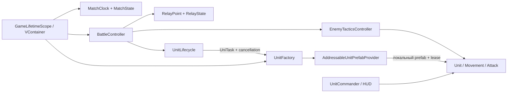

# SectorLab: Relay Skirmish — Битва за узлы

Офлайновая мобильная тактика на Unity 6: три робота против трёх на компактной арене.
Нужно захватывать и удерживать узлы, набрать **45 очков** раньше противника
или вести по очкам через **180 секунд**.

Учебный портфолио-проект, разработанный с участием AI; не коммерческий опыт.


## Коротко

| | |
|---|---|
| Платформа | Android (landscape), Editor; offline, без сервисов |
| Движок | Unity 6000.6.4f1, URP 17.6, Input System 1.20, AI Navigation 2.0 |
| Архитектура | VContainer 1.19 (composition root матча), UniTask 2.5.11 (загрузка/возрождение с отменой), Addressables 2.11 (локальные префабы с явным владением handle) |
| Код | ~2,8 тыс. строк игры в `Assets/_Project/Scripts/`, ~3,9 тыс. строк тестов |
| Тесты | 63 EditMode + 124 PlayMode, все PASS на `4a06ae3` |
| Решения | 10 ADR в [`docs/adr/`](docs/adr/) |

## Игра

- **Роли.** Tank — живучий, держит узел. Scout — быстрый, перехватывает. Ranger — дальний бой.
- **Узлы.** A и B после полного захвата дают по 1 очку/с; C лечит своих на 6 HP/с.
  Нейтральный узел захватывается за 5 с, вражеский — за 10 с (нейтрализация + захват).
  Если на узле обе команды — спор: захват и эффект останавливаются.
- **Возрождение.** Погибшая роль возвращается через 10 игровых секунд; уничтожение
  отряда не заканчивает матч.
- **Противник.** ИИ раз в секунду выбирает цель: защитить свой узел, захватить
  чужой, отвести раненого на ремонт, атаковать мешающего. Использует те же
  команды, навигацию и характеристики, что и игрок, — без бонусов и телепортов.
- **Исходы.** Победа, поражение, ничья (одновременный порог или равный счёт по времени).

### Управление

- Тап по своему бойцу или карточка Tank/Scout/Ranger внизу — выбор.
- Тап по земле — движение, по врагу — атака, по узлу A/B/C — занять узел.
- Один палец с перетаскиванием — панорама, два пальца — масштаб. В Editor: мышь, drag, колесо.
- Пауза, подсказки «Как играть» (три шага при первом запуске), звук вкл/выкл
  (сохраняется), «Ещё бой» на экране результата.
- Звуки различают оружие ролей, свой захват и угрозу узлу; короткая подпись
  дублирует событие и при выключенном звуке.

## Архитектура



- **Чистые правила отдельно от MonoBehaviour.** Время, счёт, исходы, захват и
  выбор целей ИИ — обычные классы (`MatchRules`, `MatchState`, `RelayState`,
  `EnemyDecisionRules`, `RespawnTimer`) с EditMode-тестами. Всё считается по
  игровому `deltaTime`: результат не зависит от FPS, пауза замораживает всё.
- **Один scope на матч.** Службы матча регистрируются в `GameLifetimeScope`;
  компоненты получают зависимости один раз, `Resolve` в `Update` нет.
- **Явное владение ресурсами.** Каждый Addressables-экземпляр держит lease и
  освобождает его при смерти или выгрузке. Отменённая загрузка дожидается
  окончания IO и освобождает reference без позднего спавна. Это проверяют тесты
  отмены, ошибок загрузки и десять подряд реальных перезапусков.
- **Данные вместо `if` по именам.** Узлы настраиваются `RelayConfig`, роли и
  характеристики — `UnitStats`/`UnitRoster`.

### С чего читать код

1. [`MatchRules`](Assets/_Project/Scripts/Battle/MatchRules.cs), [`RelayState`](Assets/_Project/Scripts/Objectives/RelayState.cs) — правила матча и захвата.
2. [`GameLifetimeScope`](Assets/_Project/Scripts/Battle/GameLifetimeScope.cs) → [`BattleController`](Assets/_Project/Scripts/Battle/BattleController.cs) — сборка и тик матча.
3. [`UnitLifecycle`](Assets/_Project/Scripts/Units/UnitLifecycle.cs), [`UnitFactory`](Assets/_Project/Scripts/Infrastructure/UnitFactory.cs), [`AddressableUnitPrefabProvider`](Assets/_Project/Scripts/Infrastructure/AddressableUnitPrefabProvider.cs) — async-спавн и возрождение.
4. [`EnemyDecisionRules`](Assets/_Project/Scripts/AI/EnemyDecisionRules.cs), [`EnemyTacticsController`](Assets/_Project/Scripts/AI/EnemyTacticsController.cs) — ИИ.
5. [`UnitCommander`](Assets/_Project/Scripts/Player/UnitCommander.cs) — тапы, drag, pinch и приоритеты целей касания.

Подробный маршрут изучения — [STUDY_WALKTHROUGH](docs/agent_execution/STUDY_WALKTHROUGH.md).

## Запуск

Нужны **Unity 6000.6.4f1** (для APK — Android Build Support с SDK/NDK/OpenJDK), Git и Git LFS.
Первый импорт пакетов требует доступа к registry/GitHub; сама игра использует только локальный контент.

```powershell
git clone https://github.com/ZheleznovAG/SectorLab.git
git -C SectorLab lfs pull
```

Откройте проект в Unity Hub, затем `Assets/_Project/Scenes/Main.unity` и Play.
Сцена, NavMesh, префабы и настройки Addressables лежат в Git; генераторы запускать не нужно.

### Android APK

Готовые APK публикуются на странице [Releases](https://github.com/ZheleznovAG/SectorLab/releases)
(debug-подпись Unity, `com.zheleznovag.sectorlab`).

```powershell
powershell -NoProfile -File Tools/build-android.ps1 -Task local-v1
```

APK появится в `Builds/Android/`, отчёт со SHA-256 и составом контента — в
`docs/agent_execution/evidence/android-build-<Task>.json`.

### Тесты

**Window → General → Test Runner**, сборки `SectorLab.Tests.EditMode` и
`SectorLab.Tests.PlayMode`. PlayMode-тесты гоняют настоящую сцену Main с NavMesh,
виртуальными касаниями, загрузкой/отменой/ошибками ресурсов и перезапусками.
Из командной строки при открытом Editor:

```powershell
powershell -NoProfile -File Tools/verify-unity.ps1 -Mode EditMode -Task local-check
powershell -NoProfile -File Tools/verify-unity.ps1 -Mode PlayMode -Task local-check
powershell -NoProfile -File Tools/check-repository.ps1
```

`check-repository.ps1` требует `rg` (ripgrep) и Gitleaks 8.30.1 — см.
[PRIVACY_AUDIT](docs/agent_execution/PRIVACY_AUDIT.md). Коммиты используют
`core.hooksPath=.githooks` и GitHub noreply.

## Статус

Версия 1.0 реализована: игровой цикл, ИИ, возрождение, HUD, жесты, обучение,
звук, перезапуск. Автоматические проверки и Android-сборка проходят. Ранние APK
запускались на Android (Android 11); там же подтверждены жесты и
системные отступы.

ARM64 APK в Android Emulator x86_64 (API 30–35) падает в нативном коде Unity
(SIGILL на инструкции SEVL в ARM-трансляторе); исходный прототип падает так же. Телефонной проверки это не заменяет —
[отчёт](docs/agent_execution/ANDROID_EMULATOR.md).

Подробности: [сводка статуса](docs/agent_execution/IMPLEMENTATION_STATUS.md),
[приёмочные gates](docs/agent_execution/GATES.json),
[доказательства](docs/agent_execution/EVIDENCE_REPORT.md).

## Границы

Одна карта, 3×3, без сети, прогрессии, экономики, ECS/DOTS и внешних сервисов.
Графика — примитивы Unity и простые материалы. Лицензии пакетов и происхождение
ассетов — [THIRD_PARTY_NOTICES](docs/THIRD_PARTY_NOTICES.md).
