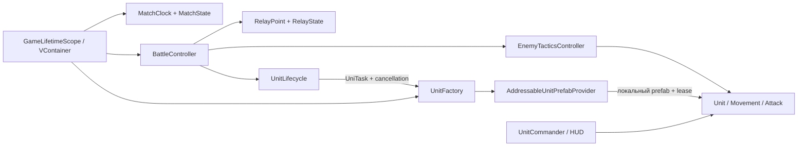

# SectorLab: Relay Skirmish — Битва за узлы

Офлайновая тактика для Android: три робота против трёх на одной компактной арене.
Tank удерживает позиции, Scout перехватывает узлы, Ranger поддерживает огнём.
Нужно набрать **45 очков**, контролируя A/B, и пользоваться ремонтным узлом C.
Партия длится не больше **180 игровых секунд**. Разработка ведётся с участием AI;
это учебный проект, а не заявленный коммерческий опыт.

Игровой цикл, AI, возрождение, HUD, жесты, обучение, звук и перезапуск реализованы.
Точные границы проверок и оставшиеся задачи: [статус](docs/agent_execution/IMPLEMENTATION_STATUS.md),
[приёмочные gates](docs/agent_execution/GATES.json), [доказательства](docs/agent_execution/EVIDENCE_REPORT.md).
Полная приёмка v1.0 требует человеческой партии и проверки актуального APK;
подтверждение свайпа/масштаба на предыдущем APK не заменяет эти проверки.


## Как играть

- Выберите синего бойца на поле или кнопкой Tank/Scout/Ranger снизу.
- Нажмите на землю для движения, на красного бойца для атаки, на A/B/C для занятия узла.
  Можно пользоваться кнопками узлов сверху. Выбор и точка назначения отмечены жёлтым.
- A/B дают по **1 очку/с** после полного захвата. Свои бойцы могут уйти;
  присутствие врага и неполный захват приостанавливают доход.
- Нейтральный узел захватывается за **5 с**, полностью вражеский — за **10 с**.
  При присутствии обеих команд захват и эффект узла остановлены.
- C восстанавливает **6 HP/с** своим живым бойцам внутри при полном владении
  и отсутствии противника. C не приносит очки.
- Погибшая роль возвращается через **10 игровых секунд** с полным HP.
  Выдайте новому бойцу приказ. Занятая база безопасно откладывает появление.
- На телефоне короткое касание выдаёт приказ, перетаскивание одним пальцем двигает
  камеру, два пальца меняют масштаб. В Editor работают мышь, drag и колесо.
- «Пауза» останавливает бой, захват, ремонт и возрождение; «Продолжить» возобновляет.
  «Помощь» открывает три подсказки, «Звук» сохраняет включение/выключение после перезапуска.

На 45 очках матч завершается. Одновременный порог — ничья; через 180 с сравнивается
счёт. Уничтожение отряда не завершает игру. На экране результата «Ещё бой»
полностью перезапускает матч. При ошибке ресурсов доступны «Повторить» и «Выйти».

## Демонстрация за 3–5 минут

1. Запустите Main / установленный APK; прочитайте или пропустите подсказки.
2. Отправьте Tank и Ranger на A, Scout сначала поддержит A, затем попробует занять B.
   Следите за противником и выдавайте приказы возродившимся бойцам.
3. Попробуйте C для раненого бойца: лечение требует своего полного владения.
   Сравните потерю времени на ремонт с очками от A/B.
4. Проверьте жесты, паузу, звук; доведите матч до результата и нажмите «Ещё бой».
   Узлы снова нейтральны, счёт нулевой, все роли доступны.

Это пример проверки игрового цикла; победа не гарантируется одной расстановкой.

## Запуск проекта

Требуются **Unity 6000.6.4f1**, Android Build Support с SDK/NDK/OpenJDK,
Git и Git LFS. Пакеты зафиксированы в manifest и lock; первый импорт UPM
требует доступа к registry/GitHub. Сама игра использует локальный контент.

```powershell
git clone https://github.com/ZheleznovAG/SectorLab.git
git -C SectorLab lfs pull
```

Откройте проект через Unity Hub, дождитесь импорта, выберите Android в
**File → Build Profiles**, откройте `Assets/_Project/Scenes/Main.unity` и нажмите Play.
Editor-генераторы повторно запускать не требуется: сцена, NavMesh, roster,
префабы и Addressables settings сохранены в Git.

## Android APK

Профиль Android использует `com.zheleznovag.sectorlab`, горизонтальную ориентацию
и локальную группу `Local Units`. Addressables настроен на сборку вместе с Player;
remote catalog и проверка обновлений отключены. APK и ключи подписи не хранятся в Git.

В Editor: **File → Build Profiles → Android → Build**. Для проверяемой сборки
при открытом Editor и установленном Unity CLI:

```powershell
powershell -NoProfile -File Tools/build-android.ps1 -Task local-v1
```

Используйте новое имя Task для каждой сборки. APK появится в
`Builds/Android/SectorLab-local-v1.apk`; JSON с исходным HEAD, хешами файлов,
результатом BuildReport, SHA-256 APK и встроенного контента — в
`docs/agent_execution/evidence/android-build-local-v1.json`. Это локальный APK со штатной debug-подписью Unity; публичный релиз и собственная подпись отдельно не выполнялись.

Последняя локальная сборка: `Builds/Android/SectorLab-W8-selection.apk`, 1.0.0,
32 302 469 bytes, checkpoint `0ae98c8`. [Build report](docs/agent_execution/evidence/android-build-W8-selection.json)
содержит SHA-256 и состав встроенного контента.

## Проверки

**Window → General → Test Runner**: сборки `SectorLab.Tests.EditMode` и
`SectorLab.Tests.PlayMode`. Они проверяют реальные правила, отрицательные сценарии,
виртуальные касания, Main/NavMesh, загрузку/отмену/ошибки и десять перезапусков.
Скриптовые партии не считаются игрой человека.

```powershell
powershell -NoProfile -File Tools/verify-unity.ps1 -Mode EditMode -Task local-check
powershell -NoProfile -File Tools/verify-unity.ps1 -Mode PlayMode -Task local-check
powershell -NoProfile -File Tools/check-repository.ps1
powershell -NoProfile -File Tools/check-gates.ps1 -RequireComplete
```

```powershell
powershell -NoProfile -File Tools/measure-android.ps1 -Task device-workload -DurationSeconds 600 -AutoRestart -ApkPath Builds/Android/SectorLab-W8-selection.apk
```

Это SurfaceFlinger FPS, CPU одного процесса и PSS/RSS, с нажатием существующей
кнопки «Ещё бой» по экрану результата. Скрипт сохраняет JSON, samples и raw frame
timestamps; Mono GC/GPU time без Unity Profiler недоступны. Имя Task должно быть
новым. Он не заменяет человеческую партию.

Последняя команда намеренно возвращает ошибку, пока gates не завершены.
Privacy gate требует Gitleaks 8.30.1 в PATH или локальном каталоге инструмента;
инструкции и ограничения очистки истории — в [PRIVACY_AUDIT.md](docs/agent_execution/PRIVACY_AUDIT.md).
Для Git-коммитов используются `core.hooksPath=.githooks` и GitHub noreply identity;
pre-commit проверяет staged-файлы, стандартные LFS hooks сохранены.

## Архитектура



Службы матча принадлежат одному scene scope. Компоненты получают зависимости
один раз; Resolve в Update отсутствует. UniTask ждёт настоящую загрузку и
возрождение с отменой. Каждый Addressables reference имеет владельца:
при смерти/выгрузке экземпляр освобождает lease; отменённая загрузка сохраняет
reference до физического окончания IO и затем освобождает его без позднего спавна.

Код — `Assets/_Project/Scripts/`, данные — `Assets/_Project/Data/`,
тесты — `Assets/_Project/Tests/`. Причины решений — [ADR](docs/adr/),
лицензии — [THIRD_PARTY_NOTICES](docs/THIRD_PARTY_NOTICES.md),
порядок изучения — [STUDY_WALKTHROUGH](docs/agent_execution/STUDY_WALKTHROUGH.md).

## Границы поставки

Одна карта, 3×3, без сети, прогрессии, ECS/DOTS и внешних игровых сервисов.
Mobile использует простые материалы и жёсткие тени. Стартовые пакеты Unity
сохранены; версия Editor не обновлялась.

63/63 EditMode и 112/112 PlayMode прошли на `0ae98c8`; публичный fresh clone
также проверен после исправления пяти legacy frame waits. Ранние APK реально
запускались на Android / Android 11; жесты и системные отступы проверены. Реальная foreground серия дала 29,86 FPS
преимущественно на экране результата; её границы записаны в отчёте. Native AssetPackManager probe воспроизводится и в исходном APK без Addressables;
он не назван устранённым. Финальное прослушивание mute/отзыв по игре ещё открыты.

Личные метаданные старой Git-истории удалены из опубликованной main по явному
разрешению владельца; код, ассеты, сообщения и даты всех 79 коммитов сохранены.
[Аудит и карта SHA](docs/agent_execution/PRIVACY_AUDIT.md) объясняют соответствие
старых доказательств новой истории. Новые коммиты защищены privacy gate. APK/release не публиковались, лицензия основного проекта не менялась. Последние исправления и отчёты сохранены локально; опубликованная `origin/main`
остаётся на `0b2badb`. Обычный push отдельно не выполнялся.
