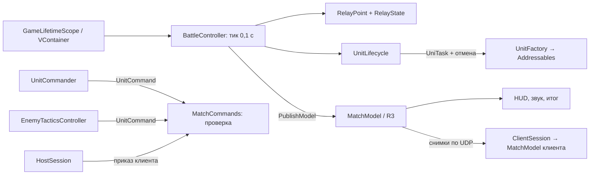

# SectorLab: Relay Skirmish — Битва за узлы

Мобильная тактика на Unity 6: три робота против трёх на компактной арене. Нужно захватывать и удерживать
узлы и набрать **45 очков** раньше противника или вести по очкам через **180 секунд**. Противник — ИИ
или второй игрок по Wi-Fi.

Учебный портфолио-проект, разработанный с участием AI; не коммерческий опыт.

> **English.** A small mobile tactics game in Unity 6: three robots a side fight over capture points on one arena,
> against an AI or a second player over Wi-Fi (authoritative host on Unity Transport). A portfolio project built
> with AI assistance, showing VContainer, UniTask, Addressables and R3 in real gameplay code, with 263 automated tests.
> Docs are in Russian; start with [AGENTS.md](AGENTS.md) and [docs/STATUS.md](docs/STATUS.md).

[](https://media.githubusercontent.com/media/ZheleznovAG/SectorLab/main/docs/media/gameplay-v1.2.0.mp4)

[Смотреть полный матч со звуком — MP4, 1:34, 720p/30 FPS](https://media.githubusercontent.com/media/ZheleznovAG/SectorLab/main/docs/media/gameplay-v1.2.0.mp4).
Выше — GIF на 14 секунд. Записан Windows-плеер 1.2.0; приказы в матче против ИИ автоматизированы.

## Скачать

APK для Android 8.0+ (arm64) — на странице [Releases](https://github.com/ZheleznovAG/SectorLab/releases)
(последняя — **1.1.0**, pre-release). Подпись — debug-ключ Unity,
поэтому Android попросит разрешить установку из неизвестного источника. Что нового — [CHANGELOG](CHANGELOG.md).

Локально собран кандидат **1.3.1** (code 5): `Builds/Android/SectorLab-v1.3.1.apk`.
[Сборка и сверка Android-бандлов](docs/evidence/android-build-v1.3.1.json) подтверждены;
запуск этой версии на физическом телефоне ещё не проверен. APK не входит в исходники Git.
[Приёмка сети двумя Windows-процессами](docs/evidence/network-v1.3.1.json) — 16/16 PASS.
Старый локальный APK 1.2.0 неполон: каталог без бандлов, см. [результаты ревью](docs/review/REMEDIATION_2026-10-27.md).

## Коротко

| | |
|---|---|
| Платформа | Android (landscape), Editor, Windows-плеер для сетевой игры |
| Движок | Unity 6000.6.4f1, URP 17.6, Input System 1.20, AI Navigation 2.0 |
| Технологии | VContainer 1.19 (composition root матча), UniTask 2.5 (загрузка и возрождение с отменой), Addressables 2.11 (локальные префабы с явным владением), R3 1.3 (реактивная модель матча), Unity Transport 6.6 (UDP, авторитетный хост) |
| Код | 103 собственных C# файла: 59 игровых, 42 тестовых и 2 Editor-инструмента |
| Тесты | 88 EditMode + 175 PlayMode, все PASS; приёмка сети — 16 проверок двух процессов (27.10.2026); процент покрытия кода не измерен |
| Решения | 24 ADR в [`docs/adr/`](docs/adr/) |

## Игра

- **Роли.** Tank — живучий, держит узел. Scout — быстрый, перехватывает. Ranger — дальний бой.
- **Узлы.** A и B дают по 1 очку/с, C лечит своих на 6 HP/с. Нейтральный узел захватывается за 5 с,
  вражеский — за 10 с. Если на узле обе команды — спор: захват и эффект останавливаются.
- **Возрождение.** Погибшая роль возвращается через 10 игровых секунд.
- **Противник-ИИ** раз в секунду выбирает цели: защитить, захватить, отвести раненого на ремонт,
  атаковать. Команды, навигация и характеристики — те же, что у игрока.
- **По сети.** «Сеть» → «Создать игру» на одном устройстве, «Подключиться» по IP на другом
  (одна Wi-Fi сеть). Хост считает партию; клиент видит её со своей стороны — «ВЫ» у него красные.

Подробные правила и цифры — [docs/GAME_DESIGN.md](docs/GAME_DESIGN.md).

## Архитектура



- **Чистые правила отдельно от `MonoBehaviour`**: время, счёт, захват, исходы, ИИ — обычные классы с EditMode-тестами.
- **Симуляция по тику 0,1 с.** Таймеры боя, узлов и счёта идут по тику матча; готовые выстрелы
  применяются после общей подготовки. NavMesh, движение и поиск цели обновляются покадрово,
  поэтому FPS может влиять на исход. В сети результат определяет авторитетный хост.
- **Приказы — данные** с проверкой «матч идёт, юнит жив и твой, цель допустима» — одинаково для тапа
  и для приказа по сети.
- **Представление подписано на реактивную модель** и не знает, считается ли матч здесь или на хосте.
- **Явное владение ресурсами**: каждый Addressables-экземпляр держит аренду; отмена при перезапуске
  не даёт позднего спавна. Проверено тестами отмены, ошибок загрузки и десяти перезапусков.

Подробно — [docs/ARCHITECTURE.md](docs/ARCHITECTURE.md), с чего читать код — там же.

## Запуск

Нужны Unity **6000.6.4f1** (для APK — Android Build Support), Git, Git LFS, Python 3.9+.

```sh
git clone https://github.com/ZheleznovAG/SectorLab.git && cd SectorLab
git lfs pull
python Tools/sl.py doctor
```

Откройте проект в Unity Hub, сцену `Assets/_Project/Scenes/Main.unity` и нажмите Play. Сцена, NavMesh,
префабы и настройки Addressables лежат в git; генераторы запускать не нужно.

При открытом Editor (Windows, macOS, Linux):

```sh
python Tools/sl.py test --task local-check          # EditMode + PlayMode
python Tools/sl.py build-android --task local-apk   # Builds/Android/SectorLab-local-apk.apk
python Tools/sl.py install-android                  # на подключённый телефон, со сверкой SHA-256
python Tools/sl.py check                            # гигиена репозитория и приватность
```

Всё про окружение, тесты, сборку и телефон — [docs/DEVELOPMENT.md](docs/DEVELOPMENT.md).

## Статус

Версия 1.0 закончена: игровой цикл, ИИ, возрождение, HUD, жесты, обучение, звук, перезапуск.
В версии 1.1.0 добавлена сетевая игра и улучшены управление, длительность боёв и обратная связь.
Кандидат 1.3.0 исправляет упаковку Android-контента и ошибки смены сетевой роли, показывает
авторитетные линии выстрелов на клиенте и допускает взаимный готовый огонь. Кандидат 1.3.1
добавляет исправления [аудита 27.10](docs/audit/2026-10-27-complex-audit.md). Протокол v3:
для сетевой игры обоим участникам нужна одна версия. Проверки текущей реализации —
[88 EditMode](docs/evidence/tests-audit-2026-10-27-full-editmode.json),
[175 PlayMode](docs/evidence/tests-audit-2026-10-27-full-playmode.json) и 16 двухпроцессных UDP-проверок.

В GitHub на push/PR выполняются [быстрые проверки](https://github.com/ZheleznovAG/SectorLab/actions/workflows/checks.yml):
Python 3.9/3.14 на Windows/Linux, гигиена и Gitleaks. Unity-тесты и сборки выполняются локально
через `Tools/sl.py` в установленном Editor. Подключение облачных сервисов Unity для этого не требуется.
GameCI сохранён как необязательный ручной workflow; автоматически на push/PR он не запускается.
Порядок проверок и ограничения автоматизации — [docs/CI_READINESS.md](docs/CI_READINESS.md).

Актуальное состояние, что подтверждено и что дальше — **[docs/STATUS.md](docs/STATUS.md)**.
Для агентов — [AGENTS.md](AGENTS.md).

## Границы

Одна карта, 3×3, без прогрессии, экономики, ECS/DOTS и сервисов с аккаунтами. Сетевая игра — только
в одной локальной сети. Графика — примитивы Unity. Лицензии пакетов и происхождение ассетов —
[THIRD_PARTY_NOTICES](docs/THIRD_PARTY_NOTICES.md).
