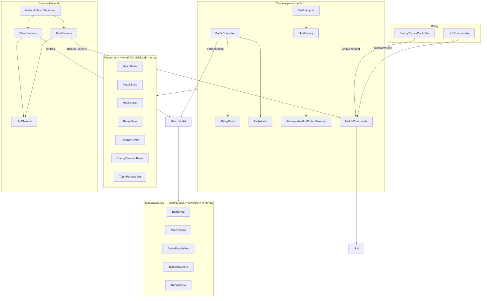
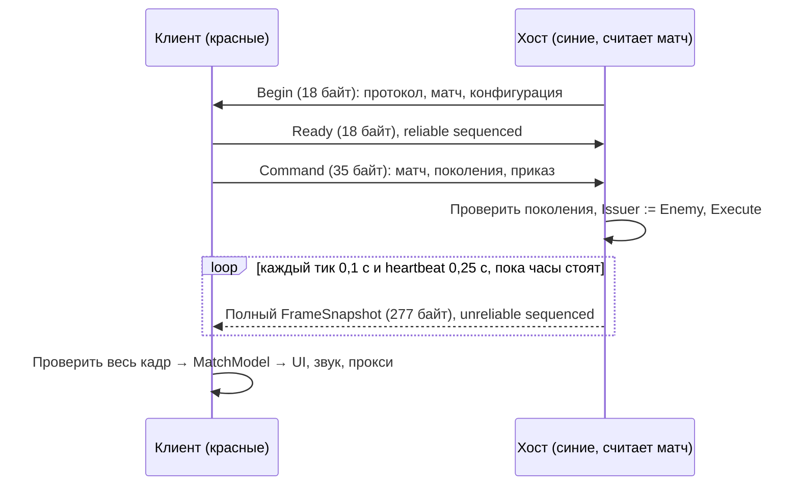

# Архитектура

Одна сцена `Assets/_Project/Scenes/Main.unity`, одна сборка кода `SectorLab` (`Scripts/SectorLab.asmdef`),
две тестовые сборки. Текущие проверки и ограничения — в [STATUS](STATUS.md).

## Слои

- **Правила** (`Battle/MatchRules`, `MatchState`, `MatchClock`, `Objectives/RelayState`, `Units/RespawnTimer`,
  `AI/EnemyDecisionRules`, `Battle/TeamPerspective`) — обычные классы без Unity. Их покрывают EditMode-тесты.
- **Симуляция.** `BattleController` копит `deltaTime` и делает фиксированные тики 0,1 с. В каждом тике
  сначала бой: `UnitAttack.TryPrepareShot` готовит все доступные выстрелы, затем применяется их урон.
  Готовый выстрел погибшего в этом же тике бойца сохраняется: взаимный смертельный огонь возможен,
  результат не зависит от порядка регистрации ([ADR-022](adr/022-simultaneous-ready-shots.md)). Затем узлы (`RelayPoint.Simulate`: захват
  и ремонт), затем счёт и время (`MatchState.Tick`), затем `PublishModel()` и событие `Ticked`
  (респаун, ИИ, сеть). Наведение, поиск цели и NavMesh-движение покадровые и тоже влияют
  на исход. Фиксированный шаг таймеров не гарантирует одинаковый матч при разном FPS.
- **Модель для зрителя.** `Battle/MatchModel` — `ReactiveProperty` R3: очки, доход, время, пауза, исход,
  прогноз, вид узлов (`RelayView`) и слотов (`UnitView`). Реактивные свойства уведомляют при изменении,
  `Updated` — после завершённой публикации. Карточки бойцов читают жизнь/HP/таймер из UnitView,
  узлы рисуются через `Show(RelayView)`. Звук использует изменения общей модели и счётчики выстрелов;
  новый матч/поколение задаёт исходное состояние без проигрывания истории.
- **Приказы — данные.** `UnitCommander` превращает тапы в `UnitCommand` и отдаёт в `ICommandSink`.
  Локально это `MatchCommands`: проверяет, что матч идёт, юнит жив и принадлежит отправителю, а цель
  допустима, и только потом двигает или атакует. На клиенте это `ClientCommandSink`, который отправляет
  приказ хосту и подтверждает только успешную постановку в очередь. ИИ использует те же команды,
  включая HoldPosition (сохранить атаку) и Stop (снять атаку).
- **Перспектива.** `TeamPerspective` от `UnitCommander.LocalTeam` превращает синих/красных в «ВЫ/ВРАГ»
  для HUD, звука и экрана итога. У красного клиента «ВЫ» — красные.

## Сборка матча и ресурсы

- `Battle/GameLifetimeScope` (VContainer) — composition root сцены: регистрирует `MatchClock`, `MatchState`,
  `BattleController`, ИИ, ростер, фабрику и провайдер префабов. Зависимости внедряются один раз;
  `Resolve` в `Update` нет ([ADR-004](adr/004-match-composition-root.md)).
- `Units/UnitLifecycle` асинхронно (UniTask) спавнит ростер (`Data/UnitRoster.asset`, 6 слотов) через
  `Infrastructure/UnitFactory` → `AddressableUnitPrefabProvider`. Каждый экземпляр держит аренду
  (`UnitPrefabLease`) и освобождает её при смерти или выгрузке. Отмена при перезапуске дожидается IO
  и не даёт позднего спавна ([ADR-005](adr/005-async-prefab-ownership.md)). Ошибка загрузки показывает
  «Повторить / Выйти».
- `MatchState.Units` — реестр конкретного матча. Фабрика привязывает юниты к нему; симуляция,
  команды, узлы, спавн, выбор и поиск противника читают этот реестр. `Unit.Id` = индекс слота;
  `Generation` увеличивается при респауне. Unit.All существует только в Editor для проверки утечек,
  игровые решения его не используют. Physics/NavMesh, Time.timeScale и NetworkLaunch по-прежнему
  предполагают одну активную игру на процесс ([ADR-020](adr/020-match-owned-units-and-ai-commands.md)).
- Причины паузы разделены: загрузка, меню, обучение, пользователь и ожидание соперника.
  Каждый владелец снимает только свою причину; клиентские окна блокируют локальный ввод
  ([ADR-017](adr/017-owned-pause-reasons.md)).
- Роли и узлы — ScriptableObject: `Units/UnitStats` (`Data/Units/*.asset`), `Objectives/RelayConfig`
  (`Data/Relays/*.asset`).

## Сеть ([ADR-013](adr/013-network-readiness.md), [ADR-014](adr/014-unity-transport-direct.md))

Авторитетный хост, не lockstep: NavMesh и float-физика недетерминированы между устройствами.

- `NetworkLaunch` — статический выбор роли (Offline/Host/Client) и канала до загрузки `Main`.
  Ставят его меню «Сеть» (`NetworkMenu`), флаги командной строки (`NetworkLauncher`) или тест.
  Ошибка переключения роли возвращает свежую Offline-сцену и одноразовое сообщение в меню;
  старое клиентское представление не остаётся без симуляции и канала.
- `NetworkMatchBootstrap` на объекте `/Battle` превращает сцену в хост или клиент. Хост отключает ИИ
  красных, шлёт снимки на `Ticked`/`Finished` и повторяет их, пока часы стоят; ждёт Ready на паузе.
  Клиент вызывает `BattleController.BecomeRemoteView()` (своей симуляции нет), делает юниты прокси
  (агент, движение и атака выключены) и показывает результат хоста. `ClientUnitView` владеет
  видимостью и HP прокси, `ClientMotion` сглаживает движение за 100 мс без экстраполяции.
  Счётчик выстрелов и `UnitView.ShotX/ShotZ` рисуют короткую линию к авторитетной точке попадания,
  без запуска клиентского `UnitAttack`. Дубликаты, новое поколение, матч и первый снимок не
  проигрывают старые линии ([ADR-023](adr/023-replicated-shot-endpoints.md)).
- `HostSession` / `ClientSession` работают поверх `IMessageChannel`. Его реализации: `LoopbackChannel`
  (в памяти, для тестов) и `UtpChannel` (Unity Transport, UDP, один удалённый игрок). `NetworkPump`
  (DontDestroyOnLoad) двигает пакеты раньше игровых скриптов и переживает перезапуск сцены.
- `MatchProtocol` согласует версию и отпечаток конфигурации, связывает приказ с поколениями матча,
  исполнителя и цели. `FrameSnapshot` объединяет MatchSnapshot и UnitsSnapshot: номер снимка,
  игровой тик/время, очки/узлы, все слоты, в том числе погибшие и загружающиеся. Кодеки полностью
  проверяют длины, enum, конечные числа и уникальность ID до записи. Старые и повторные кадры
  не применяются. SendResult отражает BeginSend/EndSend, размер и наличие соединения
  ([ADR-018](adr/018-complete-versioned-network-frames.md)). Текущий протокол v3 несовместим с v1/v2;
  обоим участникам нужна одна версия игры.

## Где что лежит

| Путь | Содержимое |
|---|---|
| `Assets/_Project/Scripts/{AI,Battle,Infrastructure,Network,Objectives,Player,Presentation,Units}` | Код игры, namespace `SectorLab.<Папка>` |
| `Assets/_Project/Tests/EditMode`, `Tests/PlayMode` | Тесты; PlayMode грузят настоящую `Main` с NavMesh |
| `Assets/_Project/Editor` | `AddressableUnitSetup` (меню сборки контента), `GameViewVerification` (размеры Game View) |
| `Assets/_Project/Data` | Ростер, роли, узлы (ScriptableObject) |
| `Assets/_Project/Prefabs`, `Materials`, `Scenes` | Префабы юнитов (Addressables, группа Local Units), материалы, сцена и NavMesh |
| `Assets/Packages`, `Assets/packages.config` | NuGet-пакеты R3 (NuGetForUnity), в git, чтобы чистый клон компилировался |
| `Packages/manifest.json` | UPM: VContainer, UniTask, R3.Unity, NuGetForUnity по git-тегам; остальное — Unity registry |
| `Tools/sl.py`, `Tools/sectorlab/` | Инструменты разработчика ([DEVELOPMENT](DEVELOPMENT.md)) |
| `.github/workflows/checks.yml`, `tests.yml` | Python Windows/Linux и гигиена на push/PR; Unity локально, GameCI — необязательный ручной эксперимент |

## С чего читать код

1. `Battle/MatchRules.cs`, `Objectives/RelayState.cs` — правила матча и захвата.
2. `Battle/GameLifetimeScope.cs` → `Battle/BattleController.cs` — сборка и тик матча.
3. `Battle/UnitCommand.cs`, `Battle/MatchCommands.cs`, `Player/UnitCommander.cs` — от тапа до приказа.
4. `Battle/MatchModel.cs`, `Presentation/BattleHud.cs` — реактивная модель и подписки HUD.
5. `Units/UnitRegistry.cs`, `Units/UnitLifecycle.cs`, `Infrastructure/UnitFactory.cs` — владение и async-спавн.
6. `AI/EnemyDecisionRules.cs`, `AI/EnemyTacticsController.cs` — ИИ.
7. `Network/MatchSessions.cs` → `Network/NetworkMatchBootstrap.cs` → `Network/UtpChannel.cs` — сеть.

## Тесты

- **EditMode** (`SectorLab.Tests.EditMode`) — правила, кодеки, перспектива: быстрые, без сцены.
- **PlayMode** (`SectorLab.Tests.PlayMode`) — грузят `Main` или синтетическую арену (`TestArena`) и ведут
  её виртуальными касаниями. Здесь проверяются загрузка, отмена и ошибки ресурсов, десять перезапусков,
  пять полных матчей тактиками игрока (`MainTacticsTests`, до 15 минут), бюджет GC-аллокаций, сеть
  через loopback и реальный UDP на localhost.
- Тесты ждут по игровому времени, а не по реальному ([ADR-008](adr/008-game-time-in-navigation-tests.md)).
  Общие ассеты, изменённые тестом, откатываются в `UnityTearDown`, а не в `finally`.
  `NetworkMatchTests` сохраняет и восстанавливает также наличие и значение настройки обучения.

## Сборка контента

Оба wrapper `sl.py build-*` сначала выбирают платформу и дожидаются Editor, очищают кеш
Addressables profile properties, затем явно собирают локальные префабы. Manifest содержит
размеры и SHA-256 каталога, settings и бандлов; готовый Player должен содержать те же байты
и платформенные пути. Один каталог без бандлов не считается успешной упаковкой
([ADR-021](adr/021-explicit-platform-content-and-artifact-validation.md)).
