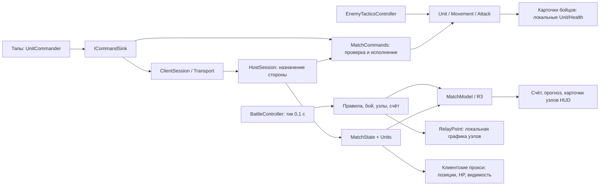

# Аудит архитектуры и реализации — 26.10.2026

База: `ba81eaa4f2e2444142dedea112f57eb6a648c5b7`, Unity **6000.6.4f1**.
Проверены runtime-код, тесты, зависимости, сборка матча, загрузка ресурсов, сеть,
представление, Python-инструменты, CI, основные руководства и архитектурные ADR.
Предыдущие аудиты: [21.10](2026-10-21-code-review.md), [22.10](2026-10-22-project-audit.md).

**Вывод:** стек соответствует небольшой тактике 3×3 и учебным целям проекта. Нужен
рефакторинг границы между авторитетной симуляцией и клиентским представлением,
затем укрепление сетевого протокола. Оснований переписывать игру целиком или менять
Unity/VContainer/UniTask/R3/Transport не найдено. В одиночном режиме жизненный цикл
ресурсов и правила заметно лучше проверены, чем полнота сетевого отображения.

## Проверки и границы выводов

- Полный свежий прогон `python Tools/sl.py test --task audit-2026-10-26`:
  **76/76 EditMode**, **154/154 PlayMode**, без failed/skipped/inconclusive.
  [EditMode](../evidence/tests-audit-2026-10-26-editmode.json),
  [PlayMode](../evidence/tests-audit-2026-10-26-playmode.json).
- `python Tools/sl.py check` — PASS: приватность, whitespace, JSON пакетов,
  255 уникальных GUID, наличие `.meta`, 167 ссылок документации. `git diff --check` — PASS.
- Дополнительный диагностический сценарий в настоящей `Main` в Play Mode:
  клиент получает снимки через `LoopbackChannel`; отдельно проверяются смена
  `HostSession` и отправка через ещё не подключённый `UtpChannel`.
  [Исходный ответ Unity](../evidence/audit-2026-10-26-runtime-probes.json),
  [подготовка](../evidence/audit-2026-10-26-client-setup.cs),
  [код проверки](../evidence/audit-2026-10-26-client-probe.cs).
- Результаты содержат `sourceHead`, хеши входных файлов и время выполнения.
  Диагностический сценарий обнаруживает дефекты; он не входит в 230 проходящих тестов.
  Пять наблюдений ниже воспроизведены в Unity, остальные выводы явно отмечены как анализ кода.
- APK в этом аудите не собирался; поведение при реальной перестановке UDP-пакетов
  и взаимодействие нескольких причин паузы отдельно не воспроизводились.
  Чистый клон на другой ОС и Python 3.9 не запускались.
- Во время работы Editor изменил только сериализованный список runtime-настроек URP;
  это побочное изменение возвращено к исходному виду. Игровой код и зависимости не менялись.
  Поле `inputHashes` в каждом отчёте сохраняет фактические входы соответствующего прогона.

## Как устроено сейчас

Это небольшой модульный монолит: одна сцена `Main`, одна runtime-сборка `SectorLab`,
две тестовые сборки, около 4,5 тыс. строк игрового кода в 51 файле. Папки и namespace
делят ответственность, но отдельные asmdef не запрещают зависимости между слоями.



Схема объясняет главный разрыв: `MatchModel` общий для локального матча и клиента,
но графика узлов, карточки бойцов и часть аудио ещё используют локальную симуляцию.
На клиенте эта симуляция отключена.

| Область / паттерн | Что реализовано | Оценка |
|---|---|---|
| Чистые правила | `MatchRules`, `MatchState`, `MatchClock`, `RelayState`, `RespawnTimer`, `EnemyDecisionRules`, `TeamPerspective` | Хорошая основа: обычные классы, отдельные EditMode-тесты. Это выделенная часть домена, а не полностью отделённая от Unity игра |
| Composition root / DI | `GameLifetimeScope`, конструкторы служб, injection компонентов, lifetime матча | Полезный и компактный VContainer; нет разрешения зависимостей из контейнера каждый кадр |
| Command | `UnitCommand`, `ICommandSink`, `MatchCommands`, транспортный адаптер | Игрок и удалённый игрок проходят общий контроль владельца/цели; ИИ пока обходит этот путь |
| Реактивное представление | `MatchModel` на R3, подписки HUD, перспектива команды | Разделение записи и чтения состояния частичное; полноценные MVVM/CQRS здесь заявлять рано |
| Factory + lease + adapter | `UnitFactory`, `IUnitPrefabProvider`, `UnitPrefabLease`, `UnitPrefabOwnership` | Явные владельцы handle и экземпляра, контролируемые отмена и освобождение |
| Данные конфигурации | `UnitStats`, `RelayConfig`, `UnitRoster` как ScriptableObject | Подходит балансу и ростеру; runtime-состояние хранится отдельно |
| Сетевая сессия | `HostSession`/`ClientSession` поверх `IMessageChannel`, loopback и UDP | Удачная тестовая граница. Контракт не возвращает результат отправки и не различает поколения матча |
| Lifetime приложения | Статические `NetworkLaunch`, `NetworkPump` с `DontDestroyOnLoad` | Сохранение соединения между матчами оправдано, но отличается от lifetime сцены и требует явного протокола перехода |

`BattleController` остаётся координатором приемлемого размера. `NetworkMatchBootstrap`
совмещает настройку роли, подключение, показ результата и обновление прокси; его
выгодно разделить при исправлении клиентского представления. Само количество методов
или применение `MonoBehaviour` не являются основанием для переписывания.

## Технологии: оставить, что улучшить

Версии сверены с [manifest](../../Packages/manifest.json),
[lock-файлом](../../Packages/packages-lock.json) и [NuGet-конфигурацией](../../Assets/packages.config).
Это оценка использования закреплённого стека, а не сравнение с самыми новыми релизами.

| Технология | Применение и рекомендация |
|---|---|
| Unity 6000.6.4f1, URP 17.6.0 | Достаточно для текущей арены. Не менять рендерер без профиля CPU/GPU и конкретной проблемы |
| AI Navigation 2.0.16 | `UnitMovement` оборачивает NavMesh, проверяет готовность агента, различает движение и достижимость. Для шести юнитов собственный поиск пути не нужен |
| Input System 1.20.1, uGUI 2.6.0 | Уже покрывают касания, выбор, камеру, safe area. Перевод интерфейса на UI Toolkit сейчас не устраняет найденные ошибки |
| VContainer 1.19.0 | Оставить. Следующий полезный шаг — внедрять контекст матча в сеть/представление вместо глобального поиска, когда эти классы будут меняться |
| UniTask 2.5.11 | Используется по делу для загрузки и ожидания респауна. Сохранить связь отмены с lifetime и явное владение результатом |
| Addressables 2.11.2 | Для трёх локальных префабов сложнее прямых ссылок, но соответствует учебной цели и уже хорошо проверен. Упрощать за счёт удаления отработанного ownership-кода невыгодно |
| R3 1.3.1 | Оставить и закончить общую модель чтения. Реактивность сама по себе не исправляет компоненты, читающие `UnitLifecycle` или события локального контроллера |
| Unity Transport 6.6.0 | Подходит 1×1 в LAN с авторитетным хостом. Основные проблемы в прикладном протоколе; смена на NGO не заменяет исправление модели состояния |
| NuGetForUnity 4.5.0 | Два способа поставки зависимостей (UPM и NuGet), но версии закреплены, DLL присутствуют. Нужна воспроизводимая CI-проверка, а не немедленная замена менеджера |
| Python CLI, Unity Pipeline 0.8.0-exp.1 | Удобный единый вход для проверок и evidence. Pipeline — зависимость среды разработки; его обновления и формат ответов надо проверять отдельно от gameplay |

**Сильная сторона — ресурсы.** Провайдер дожидается завершения Addressables IO,
проверяет отмену до передачи lease и освобождает handle в `finally`; фабрика также
освобождает lease при неудачном создании. Не следует механически добавлять раннюю
отмену в await: нужно сохранить владельца позднего результата. В закреплённом
[исходнике UniTask 2.5.11](https://github.com/Cysharp/UniTask/blob/2.5.11/src/UniTask/Assets/Plugins/UniTask/Runtime/External/Addressables/AddressablesAsyncExtensions.cs)
параметры отмены и автоматического release явно разделены.

`Lifetime.Scoped` означает экземпляр на scope и освобождение соответствующих
`IDisposable`, но не изоляцию статических переменных приложения.
[Документация VContainer](https://vcontainer.hadashikick.jp/scoping/lifetime-overview).
Поэтому наличие контейнера не делает нынешние `Unit.All` и `Time.timeScale` локальными матчу.

## Дефекты и риски по приоритету

**P1** — неверное состояние, доступное игроку в обычном сетевом матче.
**P2** — функциональная ошибка или риск при определённом порядке событий.
**P3** — долг сопровождения или усиление устойчивости. Все пункты ниже открыты;
аудит не включает исправления игрового кода.

### A1 — P1: захваченные узлы остаются нейтральными на поле клиента

**Воспроизведено.** После снимка захваченного B: `MatchModel.Relays[1].Owner = Enemy`,
но `RelayPoint.State.Owner = Neutral`, `CaptureRingFill = 0`.

Причина: [RelayPoint.UpdateVisual](../../Assets/_Project/Scripts/Objectives/RelayPoint.cs#L142)
читает собственный `RelayState`; обновление вызывается из локальной симуляции.
`BecomeRemoteView` её выключает, а `MatchSnapshot` меняет только `MatchModel`.
Карточка узла в HUD и круг на поле могут показывать разную принадлежность.

**Исправление:** отделить отрисовку узла от расчёта захвата; и хост, и клиент должны
рисовать один `RelayView`. Не запускать локальный захват на клиенте ради обновления цвета.
**Регрессия:** передать владение, частичный захват и спор; проверить кольцо, цвет и текст
самого объекта на поле, а не только значение модели.

### A2 — P1: погибший юнит остаётся живым для карточки и выбора

**Воспроизведено.** После снимка без бойца renderer выключен, но `IsAlive = true`,
кнопка доступна, карточка показывает `240/240 HP`, `SelectFriendly` возвращает `true`.

[ApplyUnits](../../Assets/_Project/Scripts/Network/NetworkMatchBootstrap.cs#L223)
меняет видимость отсутствующего прокси, но не его логическое состояние. При этом
[BattleHud.Refresh](../../Assets/_Project/Scripts/Presentation/BattleHud.cs#L208)
и [UnitCommander.SelectFriendly](../../Assets/_Project/Scripts/Player/UnitCommander.cs#L257)
проверяют локальный `Unit.IsAlive`. `Health.SetReplicated` сохраняет минимум 1 HP.

**Исправление:** явное состояние слота для представления: присутствие/жив, HP,
оставшийся респаун; общий источник для карточки, выбора и прокси. При смерти снимать
выбор. Не вызывать локальную смерть с запуском локального респауна на клиенте.
**Регрессия:** смерть выбранного бойца → недоступная карточка и сброшенный выбор →
респаун того же слота → доступная карточка с актуальным HP.

### A3 — P2: итог и предупреждения не имеют полного звукового отклика на клиенте

**Итог воспроизведён:** модель получила `Defeat`, прирост `PlayedResults` равен 0.
В [MatchAudio](../../Assets/_Project/Scripts/Presentation/MatchAudio.cs#L54) итог
подписан на `battle.Finished`, прогноз вызывается через `battle.Ticked`, выстрел —
через `UnitAttack.Fired`. Эти источники не работают на клиенте с выключенной симуляцией.
Звук захвата использует модель и не относится к этой ошибке.

**Исправление:** исход и прогноз читать из общего состояния, для выстрелов передавать
номер события/счётчик; исключить повтор звука при heartbeat. Для устойчивого прогноза
выбрать явные часы представления либо авторитетное время состояния.
**Регрессия:** клиент получает один исход многократно — звук ровно один раз; затем
новый матч снова допускает звук. Прогноз и выстрел проверить отдельно.

### A4 — P2: два частичных снимка делят один latest-only поток

**Анализ кода и установленного Transport 6.6.0.**
[HostSession.SendState](../../Assets/_Project/Scripts/Network/MatchSessions.cs#L55)
шлёт `MatchState`, затем `Units` отдельными сообщениями. В
[UtpChannel](../../Assets/_Project/Scripts/Network/UtpChannel.cs#L88) оба используют
один `UnreliableSequencedPipelineStage`. Его `Receive` сравнивает последовательность
всего pipeline: опоздавший пакет отбрасывается независимо от типа полезной нагрузки.

Если `Units(n+1)` приходит раньше `MatchState(n)`, состояние очков/узлов отбрасывается,
хотя позиции его не заменяют. Повторение снимков помогает при случайной потере,
но не устраняет конкуренцию типов сообщений и смешивание разных тиков.

**Исправление:** предпочтительно один полный снимок для шести юнитов и трёх узлов
с номером тика; альтернатива — отдельные последовательности для независимых потоков.
Снимок текущего масштаба значительно меньше буфера 1400 байт.
**Регрессия:** перестановка пары, потери нескольких тиков, дубликаты и поздний итог.
Реальная перестановка UDP в этом аудите не запускалась.

### A5 — P2: приказ не принадлежит определённому матчу

**Воспроизведено на границе сессий:** команда поставлена в очередь старой сессии,
после её Dispose создаётся новая `HostSession`; доставка даёт `Accepted = 1`.
Это проверка протокола через loopback, не воспроизведение перезапуска сцены с задержкой UDP.

`NetworkPump` сохраняет канал между сценами, `Unit.Id` повторяется по слоту ростера,
а `UnitCommandCodec` не содержит поколения матча. Повторно доставленный старый приказ
может управлять тем же слотом в следующем бою.

**Исправление:** `matchId`/epoch в командах и снимках, смена поколения только хостом,
проверка поколения до исполнения. При необходимости отдельно определить, относится
ли приказ к слоту или к конкретному воплощению бойца после респауна.
**Регрессия:** задержанный приказ предыдущего матча отклоняется, актуальный принимается;
поздний снимок старого поколения не возвращает старый итог.

### A6 — P2: успешный Submit не означает даже постановку в очередь

**Воспроизведено:** `ClientCommandSink.Submit = true`, когда канал ещё не подключён;
`DroppedSends = 1`. [UtpChannel.Send](../../Assets/_Project/Scripts/Network/UtpChannel.cs#L88)
возвращает `void`, ошибки `BeginSend` только считает, результат `EndSend` игнорирует.
`ClientSession.Send` и `ClientCommandSink` не могут передать отказ вызывающему коду.

Reliable-доставка относится к принятым транспортом данным. Она не компенсирует
потерю до постановки в очередь. Это подтверждает контракт `NetworkDriver.EndSend`
в исходнике установленного пакета: возвращаются число байт либо отрицательный код ошибки.

**Исправление:** `TrySend`/результат отправки, проверка `BeginSend` и `EndSend`,
ограниченная политика повторов и понятный отклик на отказ. Отдельно различать
«принято транспортом» и «исполнено хостом»; acknowledgement нужен только если это
обещает интерфейс. **Регрессия:** disconnected, очередь заполнена, отказ EndSend.

### A7 — P2: причины паузы могут отменять друг друга

**Анализ кода.** [TutorialView.Open/Dismiss](../../Assets/_Project/Scripts/Presentation/TutorialView.cs#L39)
сохраняет и восстанавливает один `wasPaused`; меню сети хранит собственный
`pausedByMenu`; загрузка и `OnPeerConnected` независимо вызывают `SetPaused(false)`.

Сценарий: хост ждёт соперника; открыто обучение; подключение снимает паузу, хотя
обучение ещё открыто. Его закрытие способно восстановить старое значение паузы ожидания.
Точный порядок стартовых callbacks требует отдельной регрессии.

**Исправление:** небольшой набор причин `Loading`, `WaitingForPeer`, `Tutorial`,
`UserPause` с явным владельцем каждой. Пауза снимается только когда причин нет.
Это не требует новой общей системы состояний приложения.
**Регрессия:** перекрывающиеся обучение/меню/ожидание, подключение и закрытие в обоих порядках.

### A8 — P2: заявленный Python 3.9 несовместим с записью evidence

**Подтверждено кодом и контрактом Python; запуск под 3.9 не выполнялся.**
[doctor.py](../../Tools/sectorlab/doctor.py#L16) допускает 3.9,
[common.write_evidence](../../Tools/sectorlab/common.py#L90) вызывает
`Path.write_text(..., newline="\n")`. Параметр добавлен в Python 3.10, поэтому на 3.9
запись отчёта завершится `TypeError`, в том числе после длительного прогона тестов.
[Документация Python](https://docs.python.org/3.10/library/pathlib.html#pathlib.Path.write_text).

**Исправление:** либо поддерживать 3.9 через `path.open(..., newline="\n")`, либо
поднять минимум в doctor, AGENTS и DEVELOPMENT до 3.10. Проверить короткую запись
evidence на минимальной поддерживаемой версии; весь Unity-прогон для этого не нужен.

### A9 — P3: состояние матча всё ещё частично глобальное

`Unit.All` используется боем, захватом, ИИ, выбором и поиском свободного спавна.
`Time.timeScale` и `NetworkLaunch` также общие для процесса. Поэтому два scope не
дают двух независимых матчей. Для нынешней одной сцены это ограничение архитектуры,
а не само по себе поломка игры.

**Доработка:** при следующем изменении этих потребителей ввести реестр, принадлежащий
матчу, с явной регистрацией/удалением. Не объявлять изоляцию законченной после одной
замены `Unit.All`: проверить время, scene lookup и сетевой контекст. Пока достаточно
явно закрепить правило одного активного матча на процесс.

### A10 — P3: ИИ обходит командный интерфейс

[EnemyTacticsController](../../Assets/_Project/Scripts/AI/EnemyTacticsController.cs#L150)
напрямую вызывает `Movement.MoveTo`, `Stop`, `Attack.SetTarget`, `ClearTarget`.
Это допустимо для доверенного ИИ хоста, но проверки, журнал команд и будущий replay
не охватывают его решения.

**Доработка:** преобразовать решения чистого `EnemyDecisionRules` в команды;
добавить только необходимые `Hold`/`Stop`, затем общий `ICommandSink`.
Сохранить проверенные назначения узлов и частоту принятия решений. Приоритет ниже
клиентских ошибок; универсальный behavior tree здесь не требуется.

### A11 — P3: отклонение повреждённого снимка не атомарно

В [UnitsSnapshot.Read](../../Assets/_Project/Scripts/Network/UnitsSnapshot.cs#L59)
записи помещаются в переданный массив по одной. Если поздняя запись некорректна,
метод возвращает `-1`, но начало массива `ClientSession` уже изменено, при старом
`UnitCount`. UI не получает `UnitsUpdated`, однако публичное `Units` больше не равно
последнему корректному снимку. Также нет контроля повторяющихся id.

**Доработка:** проверить всё сообщение до применения либо читать во временный
фиксированный буфер и копировать после проверки. Проверить уникальность id и
совместимость версии протокола/ростера при подключении. Регрессия: испорчена вторая
запись — вся предыдущая модель остаётся неизменной.

## Тесты, производительность и качество игры

Сильное покрытие: чистые правила и codec, подмена владельца команды на хосте,
реальные Addressables, поздняя отмена, ошибки загрузки, безопасный спавн,
десять перезапусков и освобождение старой фабрики. В свежем
[CSV перезапусков](../evidence/audit-2026-10-26-main-restarts.csv) старые экземпляры
после каждого перезапуска равны 0, новые юниты/аренды — 6/6, счёт и часы сброшены.

Но тест `NetworkMatchTests` проверяет модель, позиции, HP и выключенный renderer,
поэтому пропускает A1–A3. `NetworkSessionTests` проверяет сессии, а не итоговое
представление сцены. Реальный UDP localhost подтверждает связь, но не покрывает
перестановки, насыщение очереди и смену поколения.

`MainAllocationTests` сравнивает медианы с работающими и выключенными скриптами,
бюджет — 512 B/кадр; есть контроль с намеренными 2 KB/кадр. Это полезный детектор
постоянного мусора, а не доказательство «нулевых аллокаций» или отсутствия редких
скачков. [Исходные кадры](../evidence/audit-2026-10-26-gc-frames.csv).
Для оценки рывков потребуются хвост распределения времени кадров и спавн/загрузка;
по этому тесту нельзя делать вывод о GPU, нагреве или полном бюджете памяти.

Поиск по шести юнитам и расчёт трёх узлов не требуют ECS, пространственного индекса
или object pool. Оптимизацию таких мест начинать после измерения конкретного узкого места.
На клиенте же шаги позиции при снимках 10 Гц закономерны: нужен буфер снимков с
интерполяцией после исправления корректности состояния, с правилами teleport/respawn.

[Сценарии тактик](../evidence/audit-2026-10-26-sustained-plans.csv) дают и победы,
и поражения, с захватами, смертями и использованием ремонта. Это подтверждает,
что механики взаимодействуют; пять сценариев не доказывают баланс или удобство обучения.
Для баланса полезны серии сценариев с учётом стороны и вариаций условий, а для UX —
отдельное наблюдение поведения игроков. Рефакторинг не должен незаметно менять эти правила.

В [CI](../../.github/workflows/tests.yml) указан только `workflow_dispatch`.
Следовательно, изменение PR автоматически не запускает эти 230 тестов. История запусков
GitHub и наличие секретов в этом аудите не проверялись. Практический следующий шаг:
добиться одного воспроизводимого CI-прогона, затем включить проверки PR; быстрые
проверки Python/ссылок/приватности можно запускать независимо от лицензии Unity.

## Где документация расходилась с реализацией

| Документ / утверждение | Фактическая граница |
|---|---|
| ARCHITECTURE: HUD и звук не опрашивают симуляцию, всё представление независимо от места матча | Карточки бойцов опрашивают lifecycle раз в 0,1 с; звуки итога/прогноза/выстрела зависят от локальных событий; `RelayPoint` рисует своё состояние |
| MISSION / ARCHITECTURE / ADR-013: весь результат не зависит от FPS | Урон, кулдаун и правила тикают фиксированно, но NavMesh, поиск цели и преследование остаются покадровыми. Фиксированный шаг таймеров не гарантирует одинаковый исход при разном расписании кадров |
| ADR-013: «Что дальше» с NGO и «сеть ещё не подключена» | Это исторический план; текущий транспорт — прямой UTP по ADR-014. Его нужно явно пометить историческим |
| ADR-004: нет `DontDestroyOnLoad` | Верно для scope матча; позже появился отдельный lifetime сетевого соединения через `NetworkPump` |
| Аудит 21.10: без аллокаций в установившемся режиме | Фактический тест допускает добавочную медиану до 512 B/кадр и не характеризует редкие пики |

В ходе этого аудита текущие ARCHITECTURE/MISSION уточнены, ADR получили пояснение
границ и исторического контекста. Старые отчёты оставлены как датированные результаты.
Новые архитектурные решения этим документом не утверждаются: это предложения для
последующих изменений и ADR при изменении контракта протокола.

## Порядок доработок

| Этап | Что сделать | Критерий завершения |
|---|---|---|
| 1. Полнота клиента | A1–A3: единая модель отображения узлов и слотов, выбор, результат, события звука; выделить клиентское представление из bootstrap | Сценарий смерть → респаун → захват → итог одинаково согласован на хосте и клиенте; новые тесты сначала воспроизводят дефекты |
| 2. Контракт сети | A4–A6 и A11: снимок с tick/epoch, явный результат отправки, атомарное чтение; версия протокола | Перестановка/потеря/дубликаты/старый матч/заполненная очередь не искажают состояние и не дают ложного успеха |
| 3. Пауза и инструменты | A7–A8: владельцы паузы; согласованный минимум Python | Перекрывающиеся причины паузы сохраняются, evidence записывается на минимальной версии |
| 4. Регрессии и плавность | CI, интерполяция клиентских позиций, профиль редких пиков | Автоматическая проверка PR; плавное движение без интерполяции через смерть и респаун |
| 5. Сопровождение | A9–A10 по потребности: реестр матча, общий путь команд ИИ; возможный отдельный asmdef чистых правил | Изоляция зависимостей проверяема; поведение существующих тактик сохранено |

Каждый этап разбивать на небольшие проверенные изменения. Начать с регрессий A1/A2:
они одновременно дают видимое исправление игроку и определяют полезную границу
рефакторинга. Новые карты, способности, Relay/аккаунты и смена технологического стека
не нужны для решения найденных проблем.

## Повторение диагностического сценария

В открытом Editor с этим проектом:

```sh
unity command editor_play
unity command eval_file --file docs/evidence/audit-2026-10-26-client-setup.cs
# Дождаться UnitLifecycle.IsReady; сцену не сохранять.
unity command eval_file --file docs/evidence/audit-2026-10-26-client-probe.cs
unity command editor_stop
```

Проверка создаёт runtime-клиент и инъецирует снимки, не сохраняет сцену и не меняет
игровые ассеты. Для A5 заменяет сессии на одном loopback-канале; для A6 не вызывает
Update транспорта до отправки, поэтому соединение ещё не установлено.
