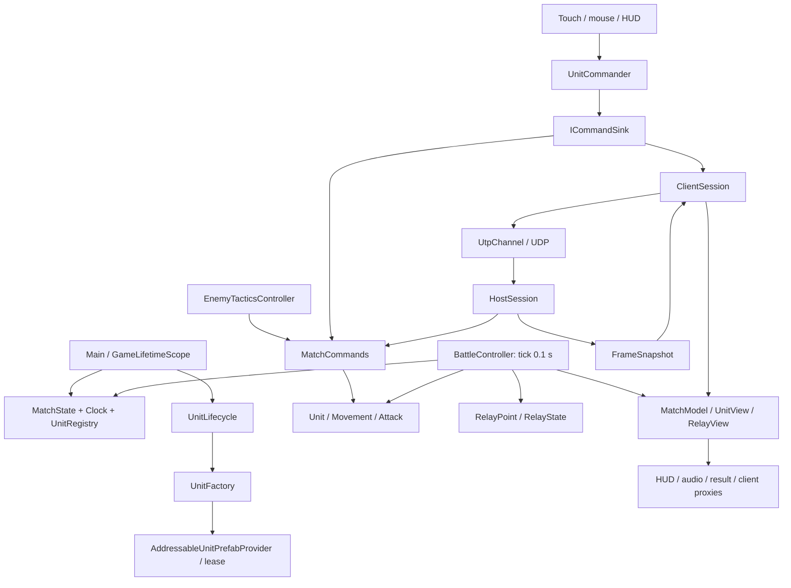

# Инженерное ревью SectorLab — 27.10.2026

## Краткий вывод

Игровая основа SectorLab работоспособна в Editor и Windows, но текущий Android-артефакт нельзя считать пригодным к приёмке: **в APK отсутствуют бандлы шести юнитов, а каталог ссылается на StandaloneWindows64** (R-07, P1). Это обнаружено и в новом APK, и в сохранённом 1.2.0. Чистый импорт, **86/86 EditMode + 168/168 PlayMode PASS** и **15/15 проверок двух Windows-процессов PASS** эту проблему упаковки не ловят.

**P0 не обнаружены; приоритетное исправление — R-07.** Дополнительно подтверждены два ограниченных сетевых дефекта: неудачная смена роли разрушает согласованность сцены и сетевого состояния (R-01), а клиент не отображает линии выстрелов (R-02). Существенные риски сопровождения — отсутствие автоматической проверки C# на PR (R-03) и блокирующий диалог первого content build (R-06). Небольшие проблемы касаются изоляции настройки обучения в тесте и перезаписи доказательств (R-04, R-05). Отдельно воспроизведено преимущество первого в реестре при взаимном смертельном выстреле; это вопрос правил боя, а не установленное нарушение дизайна (A-01).

Устройство проекта соответствует одной арене, шести бойцам, одному разработчику и двум игрокам в LAN. Оснований для переписывания игры, замены стека, внедрения ECS, дополнительного DI или сетевого сервиса не обнаружено. Основная проблема Android относится к подготовке/проверке артефакта, а не к необходимости заменить Addressables.

Главный предел уверенности — **не выполнена новая проверка на физическом Android-устройстве и реальном Wi-Fi**. Результаты Editor, сборки и localhost не доказывают качество кадров, жестов, системных панелей или восстановления после фона на телефоне. Проверка advisories также не доказывает отсутствия неизвестных уязвимостей.

## База, метод и ограничения вмешательства

- Проверялось дерево `main`, исходный HEAD `c6cf122` (`feat: record gameplay demos and showcase them in the README`). Начальный `git status --short` пустой; незакоммиченных изменений пользователя не было.
- Прочитаны действующие `AGENTS.md`, `CLAUDE.md`, STATUS, MISSION, ARCHITECTURE, DEVELOPMENT, GAME_DESIGN, актуальные ADR и предыдущие аудиты. Старые находки сверялись с текущим кодом; уже исправленные замечания не перенесены в список дефектов.
- Изучены все **59 runtime-файлов C# / 5003 строки**, оба собственных Editor-инструмента, инструментарий Python, workflow и конфигурация пакетов. Тесты: просмотр структуры всех 42 файлов / 5914 строк, подробное чтение наиболее рискованных фикстур и полный запуск обеих сборок.
- Unity, тесты, игровые пробы и сборки выполнялись в отдельном локальном клоне во временном каталоге. Исходные `Assets`, `Packages`, `ProjectSettings`, `Tools`, git-конфигурация и индекс не менялись. Unity самостоятельно пересериализует настройки в изолированной копии; это учитывается хешами входов.
- Не выполнялись коммиты, обновления зависимостей, установка APK, деплой, изменение GitHub Secrets, работа с чужими сервисами или нагрузочное воздействие на LAN. Новые постоянные файлы — этот отчёт и относящиеся к нему доказательства в `docs/review/`.
- Фактическая команда: один владелец с участием AI, по MISSION и истории. Допущение для оценки срочности: частное распространение APK как портфолио, доверенные участники LAN, отсутствие денежной экономики, аккаунтов и публичного сервера. При другом использовании сетевую модель доверия нужно пересмотреть.

Обозначения основания: **запуск** — наблюдалось в этой сессии; **код** — подтверждена цепочка реализации и проверены вызывающий код/тесты; **гипотеза** — нужны дополнительные измерения. P2 означает ограниченный дефект или существенный технический риск; P3 — небольшое улучшение.

## Фактическое устройство

### Продукт и точки входа

Одна Unity-сцена `Main`, одна игровая сборка `SectorLab`, две тестовые сборки. Основной цикл: загрузить шесть локальных префабов → выбрать бойца → занять A/B или ремонтироваться на C → бой/смерть/возрождение → 45 очков либо итог через 180 игровых секунд → повторить матч. Вместо ИИ можно подключить одного человека по IPv4/UDP.

Точки входа: `GameLifetimeScope.Configure`, Unity `Awake/Start/Update`, кнопки HUD/меню, `NetworkLauncher.FromCommandLine` (`-sectorlab-host`, `-sectorlab-join`), инструмент `Tools/sl.py`. Матч и результаты не сохраняются. `PlayerPrefs` хранит только настройку звука, просмотр обучения и последний адрес подключения. При сборке контент локальный; внешние реестры Unity/GitHub/NuGet нужны для разработки и первого импорта.



Это карта исполнения, а не строгие assembly-слои: все игровые папки компилируются вместе. Состояние живёт в памяти процесса; транзакции БД, миграции данных и серверная эксплуатация здесь отсутствуют.

### Прослеженные сценарии

| Сценарий | Полная цепочка и обработка отказа |
|---|---|
| Запуск и загрузка | VContainer создаёт один MatchState/Clock → UnitLifecycle ставит `PauseReason.Loading` → UnitFactory получает lease через Addressables → проверяет отмену, исход матча и безопасный NavMesh-спавн → экземпляр получает registry/ID/generation. Владение передаётся UnitPrefabOwnership. При отмене физическая загрузка завершается с освобождением handle; при ошибке уничтожаются экземпляры, показываются «Повторить / Выйти». Покрыто UnitFactoryTests, MainRestartTests и полным запуском. |
| Локальный приказ | Input System → фильтр UI/drag/pinch/canceled → UnitCommander → UnitCommand → MatchCommands проверяет матч, владельца, жизнь, ID и цель → NavMesh/UnitAttack → публикация модели и HUD. Непринятый move сохраняет прежнюю атаку. Покрыто жестами и настоящей Main. |
| Захват, бой, респаун | BattleController накапливает deltaTime → шаг до 0,1 с: атаки, узлы, очки/часы → модель → Ticked для ИИ/респауна/сети. RelayState учитывает только часть тика после окончания захвата; спор прекращает эффект. Смерть очищает выбор, слот получает таймер; занятая база откладывает спавн. Итог отменяет ожидающие операции. |
| LAN-подключение и приказ | NetworkLauncher создаёт UTP и живущий между сценами NetworkPump → bootstrap отключает ИИ → Begin с версией/конфигурацией/ID матча → Ready → полный кадр. Клиент посылает матч и поколения actor/target; HostSession подменяет Issuer доверенной командой стороны, затем вызывает MatchCommands. Очередь предыдущего матча/поколения отклоняется. |
| Приём состояния | UTP проверяет размер; клиент проверяет версию, матч, sequence, время, длины секций, enum, конечные числа и уникальность ID → полная валидация перед записью → MatchModel → HP/видимость/карточки/звук/интерполяция. Испорченный кадр не меняет модель частично. |
| Пауза, итог, повтор и разрыв | Раздельные pause reasons; хост повторяет снимок каждые 0,25 с без игровых тиков. Клиент показывает свою перспективу исхода, следующий Begin сбрасывает старый матч. Разрыв даёт путь «Играть с ИИ». Исключение при ручной смене роли рассмотрено отдельно в R-01. |

### Границы доверия

Хост — доверенная сторона правил и результатов; клиентское представление не ведёт симуляцию. Пакеты удалённого игрока недоверенные: кодеки ограничивают формат, команды дополнительно ограничиваются сервером. Хост не доверяет переданному `Issuer`. Хеш конфигурации — проверка совместимости, **не аутентификация**.

UDP-канал не шифруется и принимает первого подходящего участника. Это известная граница частной LAN-игры, подтверждённая `UtpChannel` и STATUS. За пределами доверенной LAN требуются отдельные требования к идентификации, защите канала и ограничениям запросов. Подключать облачный relay только ради этого ревью не требуется.

## Подтверждённые проблемы

### R-07 — P1: Android APK не содержит бандлы юнитов, хотя build wrapper сообщает успех

**Категория:** ключевой сценарий запуска на целевой платформе, сборка, ложноположительная проверка артефакта. **Основание: воспроизведён состав двух APK и чтение каталога; последствия загрузки подтверждены кодом. APK на телефоне в этой сессии не запускался.**

**Места:** [unity.py:201](../../Tools/sectorlab/unity.py#L201), [unity.py:242](../../Tools/sectorlab/unity.py#L242), [AddressableUnitPrefabProvider.cs:35](../../Assets/_Project/Scripts/Infrastructure/AddressableUnitPrefabProvider.cs#L35), [UnitLifecycle.cs:85](../../Assets/_Project/Scripts/Units/UnitLifecycle.cs#L85), [AddressableAssetSettings.asset:82](../../Assets/AddressableAssetsData/AddressableAssetSettings.asset#L82). Состав APK, его хеш и декодированные bundle references — в [доказательстве упаковки](evidence/android-packaging-20261027.json).

Стандартная команда `sl.py build-android --task review-20261027`, запущенная на чистом клоне из Editor с активной Windows-платформой, вернула Succeeded / 0 errors. В полученном архиве **нет ни одного `.bundle`**. В `assets/aa/` находятся только link.xml, catalog.bin, catalog.hash и settings.json. Настройка каталога отмечена Android, но официальный десериализатор Addressables прочитал из `catalog.bin` такие зависимости:

```text
{Addressables.RuntimePath}/StandaloneWindows64/161c6cad..._monoscripts_719e543d....bundle
{Addressables.RuntimePath}/StandaloneWindows64/localunits_assets_all_a2c0d221....bundle
```

Это сокращённые примеры путей; полные имена находятся в машинном доказательстве. Ни этих файлов, ни соответствующих Android-бандлов в APK нет. То же отсутствие обнаружено у сохранённого `SectorLab-v1.2.0.apk`, чей SHA-256 совпал с опубликованным build evidence. `androidSplitApplicationBinary=0`, отдельного asset-delivery решения в проекте нет. Windows QA с предварительным content build содержит настоящие бандлы и проходит сетевой сценарий.

На старте UnitLifecycle требует загрузить шесть префабов; стандартные BundledAssetProvider/AssetBundleProvider используют зависимости каталога. Без доступных бандлов загрузка не может завершиться штатно и ведёт к ошибке подготовки матча. Наличие каталога и успешная компиляция не подтверждают возможность начать игру. Это P1 для основного Android-продукта; для Editor/Windows дефект не воспроизведён.

В build-android нет такой же явной подготовки target/content, как в build-windows. Его guard проверяет только непустой список ZIP-элементов с префиксом `assets/aa/`; каталог сам удовлетворяет этому условию. Поэтому build wrapper ошибочно называет APK содержащим локальный контент, не проверяя зависимости каталога. Точная фаза Addressables, сформировавшая устаревшие InternalId при смене платформы, отдельно не локализована.

**Минимальное исправление:** явно выбрать Android и дождаться завершения switch/компиляции, собрать локальный контент для активного target по существующему образцу Windows, затем собрать APK. После сборки проверять, что каталог целевой платформы разрешает все необходимые локальные bundle dependencies в реальные ZIP-элементы. Одного наличия `assets/aa/` недостаточно. Новая библиотека или архитектурный слой не нужны.

**Проверка предложенного пути в этой сессии:** в изолированной копии выполнены явный switch на Android, `AddressableUnitSetup.BuildContent("review-android-explicit")`, затем существующий `build_android("review-20261027-explicit")`. Получен APK **34 474 044 байта**, SHA-256 `113F10EF18DCC1B5D98F863794A4375190458E79BCD18067D9C13C3C7A14B39C`. Его каталог ссылается на `/Android/`, оба требуемых бандла присутствуют в ZIP и имеют заголовок UnityFS; отсутствующих bundle dependencies — **0**. Правки исходников и конфигурации основного проекта не производились. Это подтверждение исправления упаковки операционной последовательностью, а не проверка запуска APK на устройстве и не исправление штатного wrapper.

**Проверка исправления:** чистый клон → Editor сначала Windows → стандартная Android-команда → каталог и бандлы Android включены, каждая bundle dependency существует в APK; затем установка и загрузка всех шести слотов на физическом телефоне. Отдельно повторить после Windows QA-сборки. Уже имеющийся 1.2.0 не следует считать проверенным на запуск на основании старого content guard.

### R-01 — P2: ошибка смены сетевой роли оставляет сцену без действующего режима

**Категория:** корректность, восстановление после частичного отказа, UI. **Основание: запуск и код.**

**Места:** [NetworkMenu.cs:167](../../Assets/_Project/Scripts/Network/NetworkMenu.cs#L167), [NetworkLauncher.cs:66](../../Assets/_Project/Scripts/Network/NetworkLauncher.cs#L66), [NetworkMatchBootstrap.cs:34](../../Assets/_Project/Scripts/Network/NetworkMatchBootstrap.cs#L34), [BattleController.cs:187](../../Assets/_Project/Scripts/Battle/BattleController.cs#L187).

`Relaunch` сначала вызывает `NetworkLauncher.Leave()`, уничтожая прежний канал и устанавливая глобальную роль Offline. Если `start()` выбрасывает перехватываемое исключение, обработчик показывает сообщение и возвращается **до** `battle.Restart()`. Bootstrap выбирает свою роль только в Start, клиентский BattleController остаётся отключённым, ИИ тоже отключён.

Пример реального условия: подключённый клиент пытается создать хост, но UDP 7777 уже занят. В адресной пробе использован существующий клиент Main и исключение `InvalidOperationException` в том же callback `Relaunch`, без занятия системного порта. Получено:

```text
globalRole=Offline; sceneRole=Client; channelCleared=true;
authority=false; simulationEnabled=false; aiEnabled=false
```

Закрытие меню не восстанавливает матч. Доступен обход через явный переход «Играть с ИИ», поэтому это P2, а не безвыходная потеря ключевого сценария.

**Минимальное исправление:** завершать неудачную смену роли целостным переходом в новую Offline-сцену либо сохранять прежнюю сессию до успешной подготовки новой. Для текущего устройства игры проще первый вариант с сохранением понятного уведомления об ошибке; новый слой сессий не нужен.

**Проверка исправления:** PlayMode-сценарий Client → ошибка создания Host → после завершения перехода роль bootstrap совпадает с глобальной, ИИ и authority активны, часы идут, новый приказ принимается. Отдельно проверить нормальные Host/Client/Offline переходы. Имеющиеся NetworkMenuTests проверяют успешные переходы и неверный IP; этот отказ не закрыт.

### R-02 — P2: сетевой клиент получает выстрел, но не рисует его линию

**Категория:** корректность представления, обратная связь боя. **Основание: запуск и код.**

**Места:** [ClientUnitView.cs:25](../../Assets/_Project/Scripts/Network/ClientUnitView.cs#L25), [UnitAttack.cs:80](../../Assets/_Project/Scripts/Units/UnitAttack.cs#L80), [UnitAttack.cs:176](../../Assets/_Project/Scripts/Units/UnitAttack.cs#L176), [UnitsSnapshot.cs:11](../../Assets/_Project/Scripts/Network/UnitsSnapshot.cs#L11), [MatchAudio.cs:95](../../Assets/_Project/Scripts/Presentation/MatchAudio.cs#L95).

На клиенте UnitAttack отключён. Единственный вызов `ShowShotLine` находится в его Simulate, который выполняется на authority. Снимок переносит счётчик Shots, но не цель/конец линии; ClientUnitView не создаёт визуальный выстрел, а MatchAudio использует счётчик только для звука.

Адресная проба в клиентской Main: после принятия нового кадра Ranger имеет `replicatedShots=1`, звук увеличился на один, при этом `attackEnabled=false`, LineRenderer существует, **видимых линий 0**. При этом здоровье, синхронизация и звук работают. Существующий ClientPresentationTests проверяет звук из счётчиков, но не визуализацию выстрелов.

**Условия и последствия:** любой LAN-матч со стрельбой; удалённый игрок получает менее понятную картину боя и не видит направления огня. На одиночный матч и серверный расчёт урона это не влияет.

**Минимальное исправление:** добавить к представлению последнего выстрела проверяемую цель/позицию попадания и коротко рисовать линию на клиенте при увеличении счётчика. Использовать те же правила отсечения старого матча/поколения, что для звука. Изменение wire format требует согласованной версии протокола и сборок. Если отсутствие линий — желаемое продуктовое упрощение, явно зафиксировать его как ограничение вместо реализации.

**Проверка исправления:** одна новая линия на новый Shots; отсутствие повторов на дубликате, старом кадре, новом поколении и новом матче; исчезновение по таймеру; визуальная проверка двух процессов. Локальные выстрелы должны сохраниться.

### R-03 — P2: успешный CI на PR не проверяет компиляцию и поведение C#

**Категория:** тестирование, CI, эксплуатационная воспроизводимость. **Основание: код workflow; облачный запуск не выполнялся.**

**Места:** [checks.yml:3](../../.github/workflows/checks.yml#L3), [checks.yml:31](../../.github/workflows/checks.yml#L31), [tests.yml:8](../../.github/workflows/tests.yml#L8), [test_evidence.py:14](../../Tools/tests/test_evidence.py#L14).

На push/PR запускаются Python-тест (один тест сериализации evidence), гигиена и Gitleaks. Unity workflow имеет только `workflow_dispatch`. Поэтому синтаксическая ошибка C# или сломанный игровой тест могут пройти все автоматические проверки PR. Это уже признанный в STATUS незавершённый этап; наличие локальных 254 PASS его не устраняет.

**Минимальное исправление:** получить один воспроизводимый Unity-прогон в выбранной среде, затем включить Unity-проверки PR. Предпочтительно явно ограничить игровые сборки, как локальная команда: `SectorLab.Tests.EditMode` / `SectorLab.Tests.PlayMode`. Сейчас в manifest есть `testables` Input System, а GameCI не задаёт assembly filter; фактический состав облачного запуска ещё предстоит подтвердить. Если облачная лицензия недоступна, допустим документированный локальный обязательный запуск или изолированный runner; не выдавать такой порядок за действующий автоматический gate.

**Проверка исправления:** намеренно неверный C# в отдельном проверочном PR делает gate красным; исправленный PR получает оба Unity-отчёта и не нулевое число игровых тестов. Проверить доступность именно образа Editor 6000.6.4f1, LFS, графики/NavMesh и продолжительность. Секреты и их значения в этом ревью не запрашивались и не менялись.

### R-06 — P2: первый автоматический content build блокируется модальным вопросом

**Категория:** сборка, воспроизводимость первого запуска, диагностика инструментария. **Основание: запуск и код пакета.**

**Места:** [unity.py:201](../../Tools/sectorlab/unity.py#L201), [AddressableUnitSetup.cs:49](../../Assets/_Project/Editor/AddressableUnitSetup.cs#L49); импортированный `Packages/com.unity.addressables/Editor/Build/DataBuilders/BuildScriptBase.cs:394`. Версия, SHA-256 файла, условие вызова и наблюдение сохранены в [доказательстве](evidence/addressables-first-build-prompt-20261027.json).

На свежем клоне первый `sl.py build-android` открыл диалог **Addressables Build Report** с вопросом о включении Debug Build Layout. Код Addressables 2.11.2 вызывает `EditorUtility.DisplayDialog`, когда пользователь ещё не видел вопрос, build layout выключен и Editor не работает в batchmode. Предусмотренный sl.py использует открытый интерактивный Editor. Пока вопрос не закрыт, `build_status` отвечает `building`, а запросы к главному потоку получают timeout. Такой период ожидания не является длительностью компиляции или проблемой производительности игры.

В этой сессии блокировка подтверждена окном своего изолированного Editor и кодом пакета; нажатие **No** позволило сборке продолжиться. Исходный проект и сторонние окна не затрагивались. В документации первого запуска этот шаг не указан; build wrapper ждёт общего таймаута, не объясняя причину.

**Минимальное исправление:** явно подготовить режим отчёта средствами Addressables перед автоматическим content build либо добавить preflight с конкретной диагностикой и документированным первым ручным шагом. Не автоматизировать произвольные нажатия окон и не обращаться к internal-флагу пакета как к стабильному API. Установка публичного режима build layout должна быть осознанной и при необходимости восстанавливать прежнее значение.

**Проверка исправления:** новый клон с новым Addressables project config → стандартная команда сборки проходит без модального ожидания либо останавливается до начала с понятной инструкцией; повторный запуск тоже работает. Отдельно подтвердить Android и Windows content build. Обычный batchmode GameCI не подпадает под это конкретное условие.

### R-04 — P3: один сетевой тест сохраняет настройку обучения

**Категория:** изоляция тестов и локального состояния. **Основание: код.**

**Места:** [NetworkMatchTests.cs:98](../../Assets/_Project/Tests/PlayMode/NetworkMatchTests.cs#L98), [NetworkMatchTests.cs:30](../../Assets/_Project/Tests/PlayMode/NetworkMatchTests.cs#L30), [TutorialView.cs:69](../../Assets/_Project/Scripts/Presentation/TutorialView.cs#L69). Для сравнения корректный шаблон — [MainLifecycleTests.cs:33](../../Assets/_Project/Tests/PlayMode/MainLifecycleTests.cs#L33) и [TutorialViewTests.cs:37](../../Assets/_Project/Tests/PlayMode/TutorialViewTests.cs#L37).

`ClientDrawsTheHostsStateAndSendsOrdersInsteadOfMovingUnits` вызывает `tutorial.Open(); tutorial.Dismiss();`. Dismiss записывает `SectorLab.Tutorial.v1=1` и вызывает PlayerPrefs.Save. Cleanup сетевой фикстуры возвращает сцену/роль/Time.timeScale, но настройку не восстанавливает. Предшествующий WaitForReady защищает только собственный вызов Dismiss и не закрывает последующий прямой вызов теста.

**Условия и последствия:** если до теста ключ отсутствовал или был нулевым, после него обучение считается просмотренным. Результат следующего первого запуска зависит от тестового прогона. Потери значимых игровых данных нет.

**Минимальное исправление:** сохранять наличие и исходное значение ключа в SetUp, восстанавливать в UnityTearDown по уже существующему шаблону. Не использовать общий DeleteAll.

**Проверка исправления:** выполнить фикстуру с отсутствующим ключом, с 0 и с 1; после каждого случая наличие и значение должны совпасть с исходными, включая выход через упавшее утверждение. Изолированный каталог проекта сам по себе не означает отдельный PlayerPrefs-профиль.

### R-05 — P3: повторное имя тестового задания перезаписывает доказательство

**Категория:** надёжность инструментария, сохранность истории проверок. **Основание: код.**

**Места:** [unity.py:91](../../Tools/sectorlab/unity.py#L91), [unity.py:118](../../Tools/sectorlab/unity.py#L118), [common.py:86](../../Tools/sectorlab/common.py#L86), [MainAllocationTests.cs:109](../../Assets/_Project/Tests/PlayMode/MainAllocationTests.cs#L109).

`run_tests` не проверяет существование `tests-{task}-{mode}.json`; `write_evidence` открывает файл в режиме `w`. Часть игровых тестов тем же task именует CSV, тоже без защиты от перезаписи. Поэтому последующий focused-прогон с именем прежнего полного может молча заменить его доказательство. В отличие от тестов, verify-network и build-windows требуют новое имя задания.

**Минимальное исправление:** до запуска тестов проверять занятость имён JSON и создаваемых CSV либо автоматически добавлять уникальный суффикс. Существующие доказательства не переписывать.

**Проверка исправления:** при занятом имени команда должна завершиться до старта Unity-тестов; SHA-256 существующего JSON/CSV остаётся прежним. Обычные два режима одного нового task должны создавать два разных отчёта.

## Архитектура и сопровождаемость

### Что соответствует масштабу

Собственный протокол здесь невелик: ограниченные структуры данных, один соперник, один authority, две транспортные pipeline. NGO добавил бы регистрацию сетевых объектов и ещё один жизненный цикл поверх уже существующих Addressables/UnitLifecycle. Его замена не решает R-01 и не оправдана ради двух игроков. Интерфейсы IMessageChannel, ICommandSink и IUnitPrefabProvider имеют реальные альтернативные реализации и полезные тестовые границы.

VContainer ограничен composition root; service locator в Update отсутствует. UniTask применяется к настоящим асинхронным загрузкам с отменой. R3 используется для модели представления; модель общая для локальной игры и клиента. Отдельные причины паузы, match-owned registry и match/generation в протоколе устранили классы ошибок, которые иначе регулярно возвращались бы при перезапуске.

Максимальный runtime-файл — UnitCommander, 328 строк; далее BattleController 258 и BattleHud 254. Чрезмерных универсальных менеджеров, огромных классов и оснований вводить новые инфраструктурные слои не найдено.

### Реальные направления зависимостей

Папки не образуют строгий однонаправленный граф: Battle ↔ Units, Battle ↔ Objectives, Battle ↔ Player; Units → Infrastructure → Battle; composition root также ссылается на AI. Это не цикл сборок — игровая asmdef одна. Но описание «чистые правила» следует понимать как POCO-логику: MatchState содержит UnitRegistry с Unity-юнитами, а TeamPerspective зависит от R3/MatchModel. Эти типы не являются полностью независимой от Unity доменной сборкой.

Для текущего размера это допустимо. Не следует автоматически дробить папки на asmdef: сначала пришлось бы разрывать реальные зависимости и менять тесты. Если появится потребность запускать правила вне Unity, минимальный полезный шаг — отделить числовые правила и их простые типы; стоимость примерно 0,5–1 день и новая проверка сборки. Сейчас такой потребности не выявлено.

`NetworkMatchBootstrap` и NetworkMenu используют FindAnyObjectByType. Для одной сцены это рабочий компромисс, причём поиск в основном происходит на границах событий. При следующей правке этих классов можно передать/закешировать нужные ссылки в уже существующем composition root. Это устранит скрытые зависимости и упростит тестирование R-01; создавать ещё один контейнер или глобальный registry не требуется.

### A-01 — P2: правило взаимного смертельного огня зависит от порядка регистрации

**Тип:** подтверждённый игровой/архитектурный компромисс, не доказанное нарушение заявленного дизайна. **Основание: запуск и код.**

**Места:** [BattleController.cs:118](../../Assets/_Project/Scripts/Battle/BattleController.cs#L118), [UnitAttack.cs:165](../../Assets/_Project/Scripts/Units/UnitAttack.cs#L165), [UnitAttack.cs:179](../../Assets/_Project/Scripts/Units/UnitAttack.cs#L179), [UnitRegistry.cs:11](../../Assets/_Project/Scripts/Units/UnitRegistry.cs#L11), [UnitRoster.asset:15](../../Assets/_Project/Data/UnitRoster.asset#L15).

Атаки применяют урон сразу при обходе реестра. После первого смертельного попадания второй юнит не стреляет из-за `!self.IsAlive`. Два свежих Tank-префаба с 5 HP, уроном 5, взаимными целями и готовым cooldown дали за один тик:

| Порядок реестра | HP синих | HP красных | Выстрелы синих / красных |
|---|---:|---:|---:|
| `[0, 3]` | 5 | 0 | 1 / 0 |
| `[3, 0]` | 0 | 5 | 0 / 1 |

В начале Main сначала создаются синие; после респауна порядок меняется. Значит, одинаковое состояние боя может решаться возрастом экземпляра. Дизайн явно определяет одновременный порог очков как ничью, но не обещает одновременное разрешение атак. Поэтому сначала нужно выбрать желаемое правило.

**Вариант улучшения:** если нужен взаимный размен, собрать намерения выстрелов всех живых на начало тика и затем применить урон; для шести юнитов достаточно маленького ограниченного буфера. Это меняет баланс и требует проверки тактических сценариев, а не только рефакторинга. Если текущая последовательность устраивает, описать её и закрепить тестом. Готовность: порядок регистрации либо не меняет результат симметричной дуэли, либо признанным правилом задаётся явный приоритет.

## Фактический стек и проверка технологий

Источники версий: ProjectVersion.txt, manifest.json, packages-lock.json, Assets/packages.config и package.json физически импортированных пакетов. **Официальные online-источники проверены 27.10.2026.** «Не найдены advisories» ниже означает результат конкретного источника на эту дату, а не сертификат безопасности.

| Компонент | Версия | Выявленная проблема / результат проверки | Источник | Действие и срочность |
|---|---|---|---|---|
| Unity Editor | 6000.6.4f1, 01.10.2026 | Поддерживаемая ветка Update; опубликована 6000.6.7f1. В ней исправлен UUM-151786: ручной выбор Android Target API мог сохранить уровень на 6 ниже. В проекте сейчас Automatic (`0`), поэтому применение дефекта к текущему APK не установлено. CVE-2025-59489 не относится к диапазону этой версии. | [Релиз 6.4](https://unity.com/releases/editor/whats-new/6000.6.4f1), [6.7 / UUM-151786](https://unity.com/releases/editor/whats-new/6000.6.7f1), [поддержка](https://unity.com/releases/unity-6/support), [security advisory](https://unity.com/security/sept-2025-01) | Срочной миграции нет. При изменении Target SDK сверить APK; при воспроизведении использовать исправленный patch. Обновление только в отдельной ветке с тестами/сборкой/телефоном. |
| URP / Core / ShaderGraph | 17.6.0 | Built-in комплект Editor, совместимость подтверждена импортом и тестами. Проблема именно URP в этой сессии не установлена. | [официальный пакет](https://docs.unity3d.com/Packages/com.unity.render-pipelines.universal@17.6/manual/index.html), lock и PackageCache | Сохранить вместе с Editor; не обновлять изолированно. |
| Input System | 1.20.1 | Реально используется для pointer/touch/pinch; проходят тесты canceled/drag/UI. Пакетные testables влияют на состав нефильтрованного GameCI-прогона. | [changelog](https://docs.unity3d.com/Packages/com.unity.inputsystem@1.20/changelog/CHANGELOG.html) | Сохранить; фильтр игровых тестов — в рамках R-03. |
| AI Navigation | 2.0.16 | Есть явная проверка complete path к узлам и отсрочка занятого спавна. Changelog предупреждает об изменении bake деревьев Terrain; текущая арена из примитивов этим не затронута. | [changelog](https://docs.unity3d.com/Packages/com.unity.ai.navigation@2.0/changelog/CHANGELOG.html) | Сохранить. Перепекать и проверять маршруты при изменении геометрии/версии bake. |
| uGUI | 2.6.0 | Достаточен для HUD и нескольких модальных окон. Проверены safe area и блокировка тапов; фактическая доступность на телефоне требует отдельной оценки. | [руководство](https://docs.unity3d.com/Packages/com.unity.ugui@2.6/manual/index.html), manifest | Сохранить. Переписывание на UI Toolkit не устраняет текущие дефекты. |
| Addressables / SBP | 2.11.2 / 3.0.3 | Владение handle корректно, remote catalog выключен. Упаковка Android теряет bundle dependencies — R-07; первый content build блокируется диалогом — R-06. | [управление памятью](https://docs.unity3d.com/Packages/com.unity.addressables@2.11/manual/MemoryManagement.html), manifest/lock, пакетный код и APK в evidence | Сохранить технологию; P1 исправить подготовку/валидацию Android-артефакта, P2 убрать модальное ожидание. Обновление библиотеки само по себе не обосновано. |
| Unity Transport | 6.6.0 | Built-in с 6.5; исправления внутри ветки идут с Editor. Протокол приложения bounded; шифрование/аутентификация не включены. | [changelog и статус built-in](https://docs.unity3d.com/Packages/com.unity.transport@6.6/changelog/CHANGELOG.html), UtpChannel | Сохранить для доверенной LAN. Интернет и недоверенные участники — отдельное решение. |
| VContainer | 1.19.0 | Git tag и lock hash совпадают с официальным релизом; опубликованных upstream advisories не найдено. Использование ограничено scope матча. | [релиз](https://github.com/hadashiA/VContainer/releases/tag/1.19.0), [advisories](https://github.com/hadashiA/VContainer/security/advisories) | Сохранить; замена не нужна. |
| UniTask | 2.5.11 | Официальный релиз; опубликованных upstream advisories не найдено. Отмена и late-result ownership протестированы. | [релиз](https://github.com/Cysharp/UniTask/releases/tag/2.5.11), [advisories](https://github.com/Cysharp/UniTask/security/advisories) | Сохранить. При обновлении повторить отмену загрузки, unload и респаун на IL2CPP. |
| R3 / R3.Unity | 1.3.1 / 1.3.1 | Версии ядра NuGet и UPM-адаптера совпадают. Опубликованных upstream advisories не найдено. | [релиз](https://github.com/Cysharp/R3/releases/tag/1.3.1), [advisories](https://github.com/Cysharp/R3/security/advisories) | Сохранить; нет оснований переходить на другую reactive-библиотеку. |
| NuGetForUnity | 4.5.0 | Editor-инструмент из официального GitHub с lock hash; опубликованных upstream advisories не найдено. Это не одноимённый пакет из npm. | [релиз](https://github.com/GlitchEnzo/NuGetForUnity/releases/tag/v4.5.0), [advisories](https://github.com/GlitchEnzo/NuGetForUnity/security/advisories) | Сохранить официальный источник. Vendored DLL должны оставаться с версиями/лицензиями и LFS. |
| NuGet-зависимости R3 | AsyncInterfaces 6.0.0; TimeProvider 8.0.0; Annotations 5.0.0; Unsafe 6.0.0; Channels 8.0.0 | В актуальных base/update NuGet VulnerabilityInfo нет записей для этих пяти ID и R3. Это отдельные библиотеки совместимости, их номера не означают использование неподдерживаемого .NET 6/8 runtime. | [API Microsoft](https://learn.microsoft.com/en-us/nuget/api/vulnerability-info), сохранённый результат запроса | Срочного обновления нет. Повторять advisory-проверку перед выпуском; Unity Mono/IL2CPP обновляется с Editor. |
| Unity Pipeline / Test Framework | 0.8.0-exp.1 / 1.8.0 | Pipeline экспериментальный и даёт выполнение C#; нужен developer/QA tooling. В package implementation сервер привязан к loopback и защищён token; runtime по умолчанию выключен, build-windows отдельно включает QA. | [Pipeline](https://docs.unity3d.com/Packages/com.unity.pipeline@0.8/manual/index.html), [соединение](https://docs.unity3d.com/Packages/com.unity.pipeline@0.8/manual/connectivity.html), manifest и build script | Сохранить фиксированную версию до необходимости обновления. Сохранять разделение QA/release и проверять это по готовому артефакту. |
| Rider / Visual Studio / Version Control | 3.0.40 / 2.0.28 / collab-proxy 2.13.6 | Инструменты Editor; runtime-код игры на них не опирается. Фактическое использование владельцем не установлено. | manifest/lock, импортированный PackageCache | Удалять только после подтверждения ненужности. Экономия импорта возможна, пользовательская польза не измерена; P3 по желанию. |
| Python / Gitleaks / Git LFS | Требование Python 3.9+; запуск 3.14.7; Gitleaks 8.30.1; LFS 3.7.1 | Python-код без сторонних runtime-зависимостей. CI проверяет 3.9/3.14 на Windows/Linux. Локальная гигиена и приватность PASS. | Tools, checks.yml, doctor | Сохранить. Проверки упаковки/отказов инструментов полезнее смены языка. |

Переход с Unity 6.6 на 6.3 LTS не предлагается: проект использует новый Android Insets API и built-in версии пакетов; это была бы обратная миграция с проверкой API и мобильного поведения. Для продукта без live-service эксплуатации её польза не доказана. Если потребуется patch-upgrade 6.6.4 → версия с нужным исправлением: ожидаемая польза — конкретный engine fix; риски — пересериализация, NavMesh/URP/Android и бандлы; объём порядка 0,5–1 дня на миграцию и проверки плюс время телефона. Обновлять пакеты только из-за нового номера не рекомендуется.

## Безопасность

Текущая проверка публикуемых файлов Gitleaks не нашла секретов, личных путей/почты или запрещённых типов. В проекте есть ignore-правила для ключей, окружений и лицензий; Gitleaks запускается в pre-commit и CI с редактированием значений. Это полезно сохранить. Вся git-история заново не сканировалась; исторические отчёты не заменяют текущую проверку.

Найдены корректные защитные меры: строгие длины/enum/finite/ID в wire codec, ограничение буфера, один сетевой соперник, отсутствие доверия к Issuer, защита от предыдущего матча и респауна, возврат результата постановки в очередь. В этой сессии не подтверждены инъекции, небезопасная десериализация или чтение произвольных файлов из игрового сетевого ввода.

PlayerPrefs здесь не содержит секретов. Debug-подпись APK и отсутствие аккаунтов допустимы для заявленного частного распространения; перед магазином потребовался бы отдельный release-процесс и ключ вне репозитория. AI-противник — детерминированные правила EnemyDecisionRules, модель/LLM не вызывается; полномочий AI-инструментов и расходов inference в игре нет.

Остаточные ограничения: любой доступный участник LAN может попытаться занять место соперника; нет прикладного бюджета числа команд за кадр; состояние и итог полностью доверены хосту. Для предполагаемой нагрузки это граница продукта. Для публичной сети/турнира с недоверенными людьми приоритет защиты вырастет; такие сценарии этим отчётом не сертифицированы.

## Производительность

**Измерено в этой сессии:** MainAllocationTests: медиана активного матча 16 923 Б/кадр, той же сцены с выключенными SectorLab-скриптами 16 923 Б/кадр, добавка **0 Б/кадр** при бюджете 512. Контроль с искусственным мусором тоже прошёл. Это Editor/Mono и медиана, а не нулевые аллокации игры вообще и не профиль Android. Числа в базовых фазах включают Editor/test runner.

**Подтверждено устройством кода:** шесть юнитов и три узла ограничивают переборы; линейный поиск ID и близких врагов оправдан. Модель использует массивы/Span, сетевые кадры — ограниченные буферы; нормальный кадр с envelope составляет 229 байт, около 2,3 КБ/с при 10 Гц без транспортных накладных расходов. Heartbeat работает и на паузе. ИИ думает раз в игровую секунду, повторные NavMesh-приказы ограничены, UI кеширует отображённые значения. MaterialPropertyBlock избегает копий материалов, аудиоклипы принадлежат сцене и уничтожаются.

Пулы объектов, spatial index и переписывание на Jobs не обоснованы. Основные кандидаты на измерение: периодические NavMeshPath в TryGetApproachPoint, пересборка текста uGUI, цена синхронного `ScheduleUpdate().Complete()` и длинные кадры на телефоне. GC-медиана легко пропускает редкую секундную аллокацию, поэтому нужен профиль p95/p99 frame time и GC spikes, особенно при респауне, конфликте узлов и перезапуске. Рекомендация измерить не является найденной утечкой или доказанным bottleneck.

## Тестирование и выполненные проверки

Тестовый набор проверяет не только методы, но реальные Main/NavMesh/Addressables, несколько завершённых партий, десять перезапусков, ошибки/отмену загрузки, занятый спавн, жесты, UI, UTP localhost, устаревшие поколения, целостность повреждённого кадра и перспективу красного игрока. Контрольный тест с искусственной аллокацией проверяет, что бюджет способен поймать регрессию. Это сильная сторона проекта.

Слабые места: отсутствуют регрессии R-01/R-02 и проверка симметричного огня A-01; Python-покрытие фактически ограничено сериализацией evidence; автоматический PR не проверяет игру. Процент line/branch coverage не измерялся — большой объём тестов не выдаётся за полный охват. Большинство числовых правил быстро проверяется EditMode, долгие PlayMode проверяют интеграцию; для текущих рисков соотношение разумно.

| Команда / проверка | Результат этой сессии | Значимые детали |
|---|---|---|
| `git status --short`, `git log --oneline -10` | PASS, чистая база | HEAD c6cf122; чужих правок нет. |
| `python Tools/sl.py doctor` | Инструменты доступны | Unity 6000.6.4f1 установлен; Editor первоначально закрыт; телефон не подключён. |
| `python Tools/sl.py check` | PASS | Приватность, whitespace, JSON, 268 уникальных GUID, `.meta`, 194 исходных документационных ссылки. Финальная проверка отчёта указана в доказательствах. |
| `python -B -m unittest discover -s Tools/tests -v` | 1/1 PASS | `test_unicode_record_uses_utf8_and_lf`. |
| Компиляция всех `.py` через `compile(...)` | PASS | Без записи bytecode; локальная версия Python 3.14.7. |
| Чистый локальный клон → Unity Editor | PASS | Успешный импорт и компиляция собственных сборок; исходный Library не переиспользовался. |
| `python Tools/sl.py test --task review-20261027 --mode both` в изолированном клоне | **86/86 + 168/168 PASS** | Ноль failed/skipped/inconclusive. Отчёты с хешами входов сохранены отдельно от прежних evidence. |
| Runtime eval через Pipeline, только изолированная Main | PASS как воспроизведение замечаний | R-01, R-02 и A-01; результат не заменяет игровой PlayMode gate. |
| NuGet VulnerabilityInfo base/update | Нет совпадений для 6 ID | Индексы обновлены 26.10 и 27.10; результат сохранён. |
| Upstream advisories R3/UniTask/VContainer/NuGetForUnity, Unity security | Проверены online | Применимых опубликованных advisory не найдено в описанных источниках. |
| Имеющийся `SectorLab-v1.2.0.apk` | SHA-256 совпал с прежним build evidence | Это проверка сохранённого файла, не новый запуск и не новая сборка. |
| `python Tools/sl.py build-android --task review-20261027` | Succeeded / 0 errors / 1 warning; **проверка полноты APK FAIL** | Первый content build ждал диалога R-06; после No завершился. В APK 1.2.0/code 3, ARM64, target API 36, но нет бандлов — R-07. Сам факт Succeeded не означает рабочую игру. |
| `python Tools/sl.py build-windows --task review-20261027-qa --qa` | Succeeded / 0 errors | Первая попытка не началась: Network error для editor_stop после Android domain reload. После подтверждения готовности Editor повтор завершился успешно. |
| `python Tools/sl.py verify-network --task review-20261027 --build-task review-20261027-qa` | **15/15 PASS** | Два настоящих Windows QA-процесса через UDP localhost; сравнение состояния, команды, смерть/респаун, узлы, результат, повторный матч, разрыв. Процессы завершены инструментом. |
| Явный Android target → BuildContent → `build_android("review-20261027-explicit")` | Succeeded / 0 errors; **проверка bundle dependencies PASS** | Оба бандла Android в APK, все ссылки каталога разрешаются в ZIP. Выполнялось в изолированной копии без правок штатного скрипта. Телефон не проверен. |

Самостоятельный C#-линтер/статический анализатор в репозитории не настроен. Проведены Unity-компиляция, ручной анализ и поиск опасных конструкций; это не выдаётся за результат Roslyn/CodeQL/SAST. Облачный GameCI, macOS/Linux Editor и установка на телефон не запускались. Для отсутствующего телефона доверие ограничено сборкой/Editor/localhost.

## Кодстайл

| Группа | Наблюдение | Оценка |
|---|---|---|
| Действующие правила | Namespace соответствует папкам, имена типов/API в основном единообразны, сериализованные поля camelCase, документация по-русски; git whitespace check проходит. `.editorconfig` и обязательных C# naming/analyzer правил нет. | Подтверждённых массовых нарушений формального стиля не найдено. |
| Плотные условные выражения | [BattleHud.cs:158](../../Assets/_Project/Scripts/Presentation/BattleHud.cs#L158), [EnemyDecisionRules.cs:57](../../Assets/_Project/Scripts/AI/EnemyDecisionRules.cs#L57), [UnitLifecycle.cs:127](../../Assets/_Project/Scripts/Units/UnitLifecycle.cs#L127): несколько вложенных ternary затрудняют чтение статусов. | P3-рекомендация сопровождаемости: при изменении выделить короткую функцию/обычный if или switch. Массовая переформатировка не нужна. |
| Комментарии об обещаниях | [UnitAttack.cs:7](../../Assets/_Project/Scripts/Units/UnitAttack.cs#L7) обещает независимость авторитетного результата от FPS. На самом деле frame-based acquisition/NavMesh меняют момент контакта; ARCHITECTURE уже честно это оговаривает. [MatchCommands.cs:11](../../Assets/_Project/Scripts/Battle/MatchCommands.cs#L11) описывает хост как будущую возможность, хотя HostSession уже вызывает Execute. | P3: уточнить комментарии при ближайшей правке. Это несогласованность текста, не новый runtime-дефект. |
| Группировка типов | MatchSessions содержит сессии, интерфейс/enum и LoopbackChannel; UnitRoster содержит слот и enum роли. | Допустимая группировка небольшого проекта. Разнести при росте, но правило «один любой тип на файл» сейчас не установлено. |
| Порядок using, однострочные методы, выбор выражений | Есть мелкие различия между файлами. | Субъективные предпочтения; дефектами не считаются. Вводить formatter только отдельным согласованным изменением. |

Мёртвых самостоятельных runtime-подсистем не обнаружено. Editor-only `Unit.All` используется тестами для диагностики утечек; это не оставшийся глобальный источник игровых решений. Удалять его как «неиспользуемый runtime API» не следует.

## Сборка и эксплуатация

Запуск и основные операции сведены в `Tools/sl.py`, версии движка/пакетов закреплены, бинарные зависимости и лицензии находятся в репозитории/LFS. В evidence есть SHA-256 входов и артефактов. Windows QA выделен отдельным флагом. Для одного владельца это разумная эксплуатационная модель, но текущая проверка Android-контента поверхностна и пропускает неработоспособный артефакт — R-07.

Окружение не полностью герметично: нужен установленный Unity CLI, активированная лицензия, Git LFS и доступ к реестрам на первом импорте; Android Target SDK выбирается автоматически из доступного SDK. Чистый импорт пересериализовал URP global settings в изолированном клоне, сборка может менять preloadedAssets. Поэтому «воспроизводимо» здесь означает успешную сборку по инструкциям с проверяемыми входами, а не побитно идентичный APK на произвольной машине.

На телефоне остаётся проверить startup, несколько партий, фон/возврат, notch/системные панели, жесты, звук и реальный LAN с потерями. У игры нет серверной базы, внешних миграций и ценных сохранений: отдельные Kubernetes, backup-сервис или серверный мониторинг не нужны. Для локальной диагностики достаточно Player/Editor logs и отчётов; имеет смысл выводить агрегированные причины disconnect/SendResult, если реальные LAN-сбои окажутся плохо различимы.

Откат — предыдущая версия APK с совместимой подписью и исходники в Git. Возможность downgrade поверх новой Android-версии без переустановки этим ревью не проверялась; не обещать сохранение PlayerPrefs при переустановке. Для частного проекта хранить предыдущий APK с хешем достаточно, а не проектировать миграционный сервис.

## Непроверенные гипотезы и пределы оценки

| ID | Гипотеза / неизвестное | Что нужно для подтверждения |
|---|---|---|
| H-01 | Периодические NavMesh/UI/сетевые операции дают заметные p95/p99 кадры на Android. Сейчас bottleneck не установлен. | Физический телефон, profiler/development build и release frame timestamps; минимум несколько партий с боем/респауном. Разделить Editor overhead, CPU, GPU и GC. |
| H-02 | Синхронный `Dns.GetHostEntry` в LocalAddressesText способен задержать открытие меню/ожидания при неисправном DNS. | Измерить длительность на тестовой сети с отказами, не менять рабочий DNS. Если подтвердится — кеш/другой способ перечисления адресов. |
| H-03 | Линейная интерполяция между снимками может срезать угол препятствия при потере нескольких кадров. Отсутствие extrapolation не доказывает отсутствие такого пути. | Запись маршрута возле стен с контролируемыми потерями/задержкой в изолированной сети; сверить визуальные позиции с геометрией. |
| H-04 | Фактический состав, продолжительность и стабильность Unity/GameCI отличаются от локального фильтрованного запуска. | Первый успешный облачный прогон с явным assembly filter; проверить image/license/graphics и опубликованные результаты. |
| H-05 | Мобильные размеры элементов, контраст и восприятие проигрыша/паузы недостаточны на отдельных экранах. | Осмотр и пользовательская проба на телефоне. Safe-area тесты и текстовые/звуковые сигналы — полезная база, но не аудит доступности. |

Не выполнялись фаззинг native UTP/IL2CPP, контролируемая packet-loss матрица, длительный soak на телефоне, проверка всей git-истории на секреты, аудит исходников каждой сторонней библиотеки, cloud license setup и магазинный release. Не исследовались персональные файлы разработчика за пределами необходимых локальных инструментов. Оговорки предыдущих Android-отчётов сохранены; они не переименованы в новый playtest.

## Решения, которые стоит сохранить

1. Общие команды для игрока/ИИ/сети и серверная проверка полномочий вместо доверия клиентскому Issuer.
2. Целый версионированный снимок, предварительная валидация, match ID + actor/target generation, отдельные sequence и simulation tick.
3. Явный lease префаба и отмена с освобождением позднего результата; проверка после десяти перезапусков.
4. Раздельные владельцы причин паузы и shared presentation model с перспективой игрока.
5. Настоящие интеграционные сценарии Main, проверка способности GC-теста обнаружить дефект, хеши evidence, честное различение Editor/автоматики/телефона.
6. Небольшой stateful проект без ненужных сервисов и универсальной событийной инфраструктуры.

## План небольших улучшений

Объёмы — ориентир для одного знакомого с проектом разработчика, без ожидания внешней лицензии/устройства. Шаги независимы, если в таблице не указано обратное.

| Шаг | Цель | Зависимости | Примерный объём | Проверяемый критерий готовности |
|---|---|---|---|---|
| 1 | Исправить R-07: подготовка target/content и проверка полноты Android APK | Нет; R-06 можно закрыть рядом небольшим отдельным изменением | 2–4 часа на build tooling и проверку зависимостей каталога, плюс сборка/телефон | После Windows → Android каталог ссылается на Android, все нужные бандлы существуют в APK; загрузка шести слотов подтверждена на телефоне. Старый артефакт не принимается по формальному Succeeded. |
| 2 | Исправить R-01: завершать неудачную смену роли в согласованном состоянии | Нет | 1–2 часа, NetworkMenu и один содержательный PlayMode-сценарий | Ошибка создания хоста из Client приводит к работающему Offline или сохраняет целиком прежнюю сессию; роли/канал/authority/ИИ совпадают. Успешные переходы проходят. |
| 3 | Закрыть R-04 и R-05: сохранность настроек и доказательств | Нет | 1–2 часа, тестовая фикстура и небольшой guard tooling | PlayerPrefs до/после совпадают; повторное имя не меняет существующие JSON/CSV и не запускает тесты. |
| 4 | Подготовить первый content build, R-06 | Нет | 1–2 часа, preflight/настройка режима и инструкция | Свежий клон не ждёт скрытого модального ответа; повторный build проходит. |
| 5 | Сделать проверку C# обязательной на PR, R-03 | Доступная лицензия/runner и подтверждённый Editor image | 0,5–1 день активной работы плюс внешняя настройка | Первый зелёный Edit/Play прогон опубликован; намеренная ошибка делает PR gate красным; запускаются нужные игровые сборки. |
| 6 | Восстановить визуальные выстрелы клиента, R-02 | Решение сохранить этот визуальный сигнал; согласованное изменение протокола | 0,5–1 день с codec/PlayMode/E2E | Линия соответствует подтверждённому выстрелу, ограничена по времени, не повторяется после stale/duplicate/respawn, обе стороны видят бой. |
| 7 | Определить семантику взаимного огня, A-01 | Продуктовое решение о размене/приоритете | 1–2 часа на правило/тест; до 0,5 дня на two-phase damage и баланс | Либо симметричная дуэль инвариантна к порядку реестра, либо приоритет явно описан и проверен. Полные тактические матчи не регрессируют. |
| 8 | Закрыть мобильную приёмку и измерения | Физический Android и второй участник/устройство LAN; APK после шага 1 | 2–4 часа проверки и записи evidence | Несколько партий и повторов, фон/возврат, жесты/notch/звук, отказ сети; записаны build hash, методика и frame-time/память. Автоматика и ручные наблюдения обозначены отдельно. |
| 9 | Точечно улучшить текст и зависимости при следующих изменениях | Нет; следовать реальной потребности | Менее 1 часа на комментарии; DI-ссылки вместе с профильной задачей | Комментарии совпадают с frame/tick моделью; изменённые классы читаются без новых универсальных слоёв. |

Первый рекомендуемый шаг — **R-07**: перенести уже используемую Windows-сборкой явную подготовку платформы/контента на Android и усилить проверку APK. Это ограниченная правка build tooling без изменения правил игры, протокола и зависимостей. Срочных массовых обновлений технологий в план не включено.

## Охват и доказательства

Подробно: числовые правила, тик/состояние/паузы, команды, UI-ввод, навигация/бой, узлы/ремонт, DI и владение загрузками, жизненный цикл юнитов, все сетевые кодеки/сессии/bootstrap/UTP, клиентское представление, звук/обучение/safe area, Python-проверки/сборки/приёмка, CI и лицензирование по конфигурации.

Выборочно: сериализованные поля Main, варианты префабов/материалы и Addressables-группы, повторяющиеся layout-значения YAML, одинаковые тестовые assertions, прошлые отчёты и исторические ADR, внутренности сторонних библиотек. Все собственные runtime-подсистемы охвачены; выборочность относится к повторяющимся ассетам и тестовым деталям, а не к пропущенному сетевому или игровому модулю.

За пределами: реальный телефон/Wi-Fi и accessibility playtest, облачный GameCI, магазинное развёртывание, security-аудит сторонних native-бинарников и внешних аккаунтов. Прежние `docs/evidence/` не заменяются.

Машинные доказательства этой сессии:

- [EditMode 86/86](evidence/tests-review-20261027-editmode.json), [PlayMode 168/168](evidence/tests-review-20261027-playmode.json).
- [Адресные игровые пробы R-01/R-02/A-01](evidence/runtime-probes-20261027.json).
- [Полнота двух исходных APK и повторного APK](evidence/android-packaging-20261027.json), [метаданные APK](evidence/android-apk-metadata-20261027.json).
- [Штатный Android build](evidence/android-build-review-20261027.json), [явный Android content build](evidence/review-android-explicit-local-content.json), [повторный Android APK](evidence/android-build-review-20261027-explicit.json).
- [Windows QA build](evidence/windows-build-review-20261027-qa.json), [локальный Windows-контент](evidence/review-20261027-qa-windows-local-content.json), [двухпроцессная приёмка 15/15](evidence/network-review-20261027.json).
- [Диалог первого Addressables build](evidence/addressables-first-build-prompt-20261027.json), [NuGet VulnerabilityInfo](evidence/nuget-advisories-20261027.json).
- [Финальные проверки гигиены, приватности, ссылок и неизменности исходников](evidence/review-verification-20261027.json).
